# Architecture: Sports Intelligence & Telegram Content Tool

> **ADR-004 (2026-10-07, `docs/adr/004-rules-first-local-llm.md`):** the base mode uses no paid AI: enrichment rules, lexical clustering, an extractive summary, a template draft and the "fake Telegram" feed. The LLM parts of the architecture (the sections on the AI gateway, prompts, grounding, budget) apply only in the optional `llm` mode with a **local** model via Ollama or the Anthropic API. Where this text conflicts with ADR-004 or the code, ADR-004 and the code win.

> Date: 2026-10-03 · The original architectural design; the implementation may have moved on, and the code is the source of truth.
> This document describes **only the architecture**. Implementation tasks are deliberately left out.

**Where to find each artifact:**

| Artifact | Section |
|---|---|
| High-Level Architecture | §1 |
| Domains, Domain Model | §2, §3 |
| Modules, Module Diagram | §4 |
| Backend Architecture, Package Structure | §5 |
| Event Flow, Data Flow | §6 |
| Background Jobs | §7 |
| AI Integration | §8 |
| Database Schema / Design | §9 |
| API Strategy / Design | §10 |
| Authentication, Authorization, Security Model | §11, §12, §13 |
| Frontend Architecture, State Management | §14, §15 |
| Notifications, Third-party Integrations | §16, §17 |
| Caching, Error Handling, Offline | §18, §19, §20 |
| i18n, Accessibility | §21, §22 |
| Configuration, Feature Flags, Environments | §23, §24, §25 |
| Logging, Monitoring, Analytics | §26, §27, §28 |
| Deployment Architecture / Strategy, CI/CD | §29, §30 |
| Testing Strategy / Architecture | §31 |
| Folder Structure (full) | §32 (details in §5.2, §14.2) |
| Evolution, risks, open questions | §33 |

Every significant decision is written up as **Why / Alternatives / Trade-offs** (in the text or in the section's decision table).

---

## 0. Context, assumptions and architectural drivers

### 0.1. Scale assumptions

The product requirements give no numbers, so the following are working assumptions. If reality turns out an order of magnitude larger, they must be revisited (section 33).

| Parameter | Assumption | Impact on the architecture |
|---|---|---|
| Sources | 20–100 (RSS, sitemap, HTML, official club and federation sites) | A simple scheduler, a per-domain request rate limit |
| Articles | 2–10 thousand/day, about 1–3 million/year | One PostgreSQL is enough, no partitioning needed |
| Users | 3–20 internal staff, desktop | No horizontal API scaling requirements |
| Latency to appear | p95 ≤ 10 min from publication by the source to the Event appearing in the UI | Polling every 2–5 min and an asynchronous pipeline |
| Dashboard response | p95 API ≤ 300 ms for a filtered list | Indexes, keyset pagination, no LLM calls in the request path |
| AI spend | A limited daily budget | Model routing, caching, a cheap model for bulk tasks |

### 0.2. Architectural drivers (by priority)

1. **Trust in facts.** AI is never the source of truth. Every statement can be traced back to a publication.
2. **Editor speed** (the "Useful Stories per Hour" metric). One Event instead of ten articles, fast filters, a Telegram preview in one click.
3. **Extensibility** of the reference data (sports, competitions, sources) without code changes.
4. **Operational simplicity.** This is an internal tool for a small team, so every extra infrastructure component is expensive.
5. **Security and compliance:** authorization, audit, respect for ToS and copyright, minimal storage of third-party texts.

### 0.3. Principles applied to every decision

- **Deterministic code for safety-critical rules; AI for data extraction.** Reliability, statuses, conflict warnings and "not confirmed" flags are computed by code. AI only supplies input features for them.
- **Minimum moving parts.** PostgreSQL serves as the store, the queue, the search engine and the vector index. Each new component (Redis, Elasticsearch, a broker) is added only when a need is measured.
- **A port only where a second implementation exists.** Abstractions appear only for external systems, which tests replace with fakes. There are no empty interfaces over our own database.
- **A human edit beats AI.** Automation never silently overwrites what a person edited.

---

## 1. High-level architecture

### 1.1. Diagram

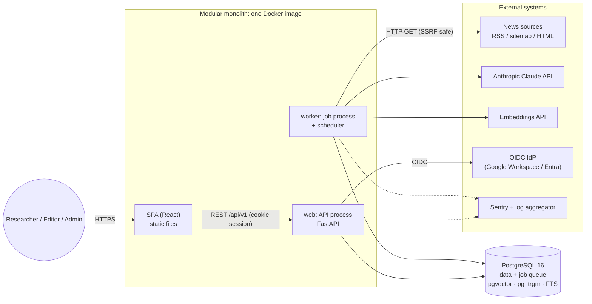

The key property: **the API never calls an LLM or external sites synchronously.** Everything slow, unreliable or potentially dangerous (network, AI, parsing third-party HTML) runs in the worker. This keeps the Dashboard fast and concentrates the SSRF surface in one process.

### 1.2. Technology stack

| Layer | Choice | Why (briefly) |
|---|---|---|
| Backend | Python 3.12, FastAPI, Pydantic v2, SQLAlchemy 2 (async), Alembic | The best ecosystem for news parsing and NLP (feedparser, trafilatura), typed schemas, OpenAPI out of the box |
| Queue and scheduler | Procrastinate (a job queue on top of PostgreSQL) | Jobs are enqueued in the same transaction as the data, so a transactional outbox comes for free. No Redis |
| Database | PostgreSQL 16 with pgvector, pg_trgm, unaccent | One system for OLTP, FTS (`portuguese`), fuzzy name search and vector search |
| Frontend | React 19, TypeScript, Vite, TanStack Query, TanStack Router, shadcn/ui (Radix), Tiptap, i18next | A desktop SPA, accessible primitives, typed routing with state in the URL |
| API contract | OpenAPI 3.1 (generated by FastAPI) → `openapi-typescript` | One source of truth for frontend and backend types |
| AI | Claude (a small model for bulk tasks, a larger one for summary and draft), embeddings via API | Structured output, good pt-BR quality, prompt caching |
| Authentication | OIDC (Authorization Code + PKCE), server-side sessions in PostgreSQL | No stored passwords, use the company SSO (password sign-in was added later, ADR-005) |
| Observability | structlog (JSON) → stdout → aggregator; Sentry; OpenTelemetry metrics → a Prometheus-compatible backend | A standard set, everything is replaceable |
| Deployment | One image, two process types (web, worker), managed PostgreSQL, PaaS or VM | Minimal operational load |
| CI/CD | GitHub Actions | The usual choice for a git repository |

### 1.3. Key architectural decisions (ADR index)

**ADR-01. A modular monolith, not microservices**
- **Why:** one small team, a single domain model (Article → Event → Draft) with strong transactional coupling, low load. Module boundaries give the same isolation benefits without distributed transactions, network failures and N deployments.
- **Alternatives:** (a) ingestion / intelligence / editorial microservices; (b) a "big ball of mud" without boundaries; (c) a serverless function per pipeline step.
- **Trade-offs:** modules cannot scale independently. This is offset by web and worker already being separate processes of one image that scale separately. Boundary discipline has to be enforced with tooling (import-linter). Criteria for extracting a service are in §33.

**ADR-02. PostgreSQL as the only stateful dependency**
- **Why:** FTS with the `portuguese` configuration, pg_trgm for player names, pgvector for clustering and the job queue, all in one database. One backup and one point of failure instead of four, transactional "data + job" consistency.
- **Alternatives:** Elasticsearch/OpenSearch for search; Redis + Celery/RQ for the queue; Qdrant/Pinecone for vectors; Kafka for events.
- **Trade-offs:** PostgreSQL FTS is weaker than Elastic at ranking and highlighting, and pgvector is slower than specialised databases at tens of millions of vectors. For 1–3 million articles a year this is enough. The migration path is in §33.

**ADR-03. Python for the backend and TypeScript for the frontend (two languages)**
- **Why:** content extraction (trafilatura), RSS (feedparser), text processing and AI provider SDKs are best in Python. TS is unrivalled on the frontend.
- **Alternatives:** an all-TypeScript stack (NestJS or Next.js + tRPC); Django.
- **Trade-offs:** no shared types out of the box; solved by generating TS types from OpenAPI. Django would give a ready admin and auth but fits Clean Architecture and an async pipeline worse. There are few admin screens (sources, taxonomy, settings), and they are easier to build in the SPA.

**ADR-04. An asynchronous job pipeline, not stream processing**
- **Why:** each step (fetch → extract → enrich → cluster → refresh) is an idempotent job with retries. Volumes are small, and a streaming platform would be overkill.
- **Alternatives:** Kafka/Redpanda; synchronous processing in a single cron script.
- **Trade-offs:** no event replay as with a Kafka log. Reprocessing is done by re-enqueueing jobs from a database query, which is enough for our volume.

**ADR-05. Telegram publishing per channel and only behind a flag** (revised 2026-10-09; previously "no auto-publishing in the MVP")
- **Why:** management needs regular delivery of briefs; manual copying does not scale to several channels and languages.
- **How:** a "Channel" entity (`editorial.channels`): chat_id, language, filters (region, sport, sources, minimum source tier, importance, reliability), mode and cron. Modes:
  - `approval`: only "Ready" events with a post in the channel's language are published; a person approved the text, and after sending the event becomes PUBLISHED.
  - `auto`: events above the thresholds with an AI brief in the channel's language; rumours are not published and the event status does not change.
- **Safeguards:** nothing is sent without `FLAG_TELEGRAM_PUBLISH=true` and `TELEGRAM_BOT_TOKEN`; `publications` UNIQUE(channel, event) prevents duplicates; Telegram errors go to the channel log.
- **Trade-offs:** the `digest` format is headlines with links, without the full text.


**ADR-06. Rules and templates first, a local LLM is optional** (details: `docs/adr/004-rules-first-local-llm.md`)
- **Why:** a zero budget; the hypothesis that templates with manual editing are enough.
- **Trade-offs:** clustering and relevance are coarser; conflict detection only works with an LLM. The `LlmClient`/`EmbeddingClient` ports stay, and the LLM is turned on step by step without changing module code.
---

## 2. Domains (Bounded Contexts)

### 2.1. Domain classification

| Domain | Type | Responsibility | Key concepts |
|---|---|---|---|
| **Events (Story Intelligence)** | **Core** | Clustering articles into events, the aggregate assessment, conflicts, the event's editorial workflow | Event, EventStatus, Conflict, Clustering |
| **Intelligence (Enrichment)** | **Core** | Understanding a single article: sport, competition, entities, claims, rumour and clickbait markers, relevance, embedding | Enrichment, Claim, RelevanceAssessment |
| **Editorial** | **Core** | Telegram drafts, versions, grounding and citations, preview and copy | TelegramDraft, DraftVersion, Citation |
| **Ingestion** | Supporting | Fetching and normalising publications, deduplication by URL and content | Article, FetchRun |
| **Sources** | Supporting | Source catalogue, polling schedule, tier and owner, ToS policy, health | Source, SourceHealth, OwnerGroup |
| **Taxonomy** | Supporting | Reference data: Sport, Competition, Team, Player, aliases | Sport, Entity, Alias |
| **Identity & Access** | Generic | Users, roles, sessions, OIDC | User, Role, Session |
| **Audit** | Generic | Immutable history of critical actions | AuditEntry |
| **Analytics** | Generic (read-only) | "Useful Stories per Hour" metrics, AI quality | Read models |

**Why Intelligence and Events are separate:** Intelligence works at the level of **one article** and knows nothing about events. Events works at the level of **many articles** and receives ready-made features from Intelligence. This lets us change enrichment models and prompts without touching clustering and workflow logic, and vice versa.
**Alternative:** a single "AI processing" module. **Trade-off:** separate modules add a contract (the enrichment DTO), but each module stays highly cohesive.

### 2.2. Context map

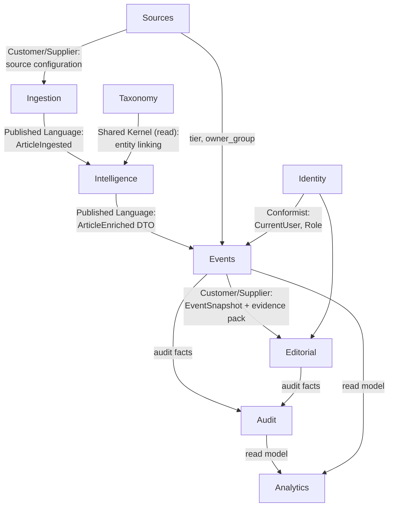

### 2.3. Ubiquitous language

| Term | Definition |
|---|---|
| **Article** | One publication by one source at one canonical URL. Immutable in substance, but may be updated (edits by the source) |
| **Event** | A real fact or story reported by 1..N Articles. The editor's unit of work |
| **Claim** | An atomic statement from an article: *subject, attribute, value, modality (confirmed / expected / rumour)* |
| **Conflict** | Contradictory values of the same (subject, attribute) in different Articles of one Event |
| **Relevance** | Importance for the iGaming audience: HIGH / MEDIUM / LOW / IRRELEVANT with an explanation |
| **Reliability** | Trustworthiness: HIGH / MEDIUM / LOW / UNKNOWN. Computed from factors, **independently** of Relevance |
| **Independent sources** | Sources with different `owner_group` (e.g. Globo and GE belong to one group and do not count as two independent confirmations) |
| **Evidence pack** | A numbered set of article fragments that AI is allowed to cite when generating |
| **Manual override** | An Event field locked against automatic overwrite after a human edit |

---

## 3. Domain model

### 3.1. Aggregates

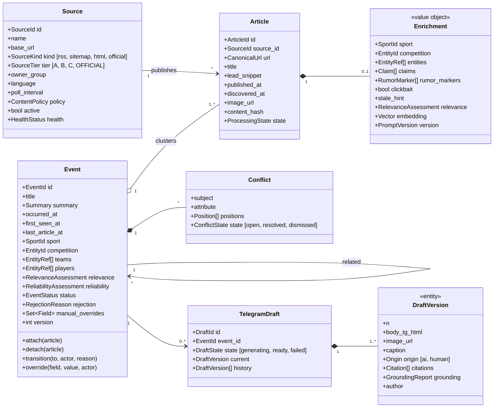

### 3.2. Value objects

| VO | Contents | Invariants |
|---|---|---|
| `RelevanceAssessment` | level, rationale (≤ 280 characters), origin (ai/rule/human), prompt_version | rationale is required for every level except IRRELEVANT |
| `ReliabilityAssessment` | level, factors[] (factor code, contribution, explanation), origin | level is **derived** from the factors by a policy function; origin=human requires a reason |
| `Summary` | text, origin (ai/human), citations[], generated_from_article_ids[] | an AI summary without citations is invalid |
| `Claim` | subject_entity, attribute (availability, transfer, score, lineup, suspension, coach, other), value, modality (confirmed/expected/rumor/denied), quote_span, article_id | quote_span must be a substring of the source text |
| `CanonicalUrl` | normalised URL (no utm, no fragment, lowercase host) | unique in the system |
| `RejectionReason` | DUPLICATE, IRRELEVANT, LOW_QUALITY, INCORRECT, OLD_NEWS, NOT_TELEGRAM_WORTHY, OTHER (+ comment) | OTHER requires a comment |

### 3.3. Event aggregate invariants

1. An Event contains ≥ 1 Article (except a manually created Event: then 0 Articles are allowed, but reliability = UNKNOWN until a source is attached).
2. `reliability.level` cannot be HIGH while the event has an open Conflict on a key attribute. In that case the level is capped at MEDIUM and the disputed claim is excluded from the "facts".
3. Fields in `manual_overrides` (title, summary, sport, competition, relevance, reliability) are not overwritten by the automatic `refresh`. Instead the `has_updates_since_edit` flag is set.
4. Status transitions follow the state machine only (§3.4). Every transition is recorded in Audit.
5. `version` increases on every change (optimistic locking).

### 3.4. Event status state machine

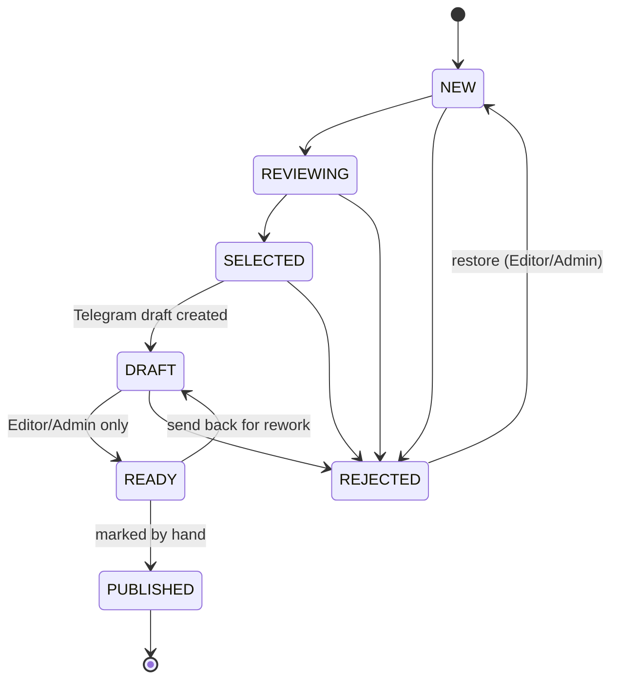

- The requirements explicitly mention only `NEW → REJECTED`. The extension (rejecting from REVIEWING, SELECTED and DRAFT, restoring) is an **interpretation**: the Reject button in the Telegram preview implies rejecting at the draft stage. The set of transitions is defined in one table in the domain policy and changes in one place.
- **Why the status belongs to the Event, not the Draft:** editors work with events. A Draft has only a technical generation status. Two parallel workflows would confuse the UI and analytics.
- **Alternative:** a separate workflow for Drafts. **Trade-off:** several draft variants of one event do not get their own statuses (not needed in the MVP: a "current version" plus history).

### 3.5. Domain policies (domain services)

| Policy | Module | Deterministic? | Description |
|---|---|---|---|
| `ReliabilityPolicy` | events | **Yes** | Factors: source tiers, number of independent `owner_group`s, presence of an OFFICIAL source, rumour markers, clickbait, open conflicts, a single source. A rule table (§8.6) |
| `RelevancePolicy` | events | Partly | Takes the maximum of the articles' AI assessments and adjusts it with deterministic modifiers (competition weight, priority teams, staleness) |
| `ClusteringPolicy` | events | Yes (with AI in the grey zone) | Candidate scoring and thresholds (§8.5) |
| `WorkflowPolicy` | events | Yes | Allowed transitions and roles |
| `GroundingValidator` | editorial | **Yes** | Checks that every sentence of a draft has a citation and that numbers, names and quotes appear in the evidence pack |
| `UrlCanonicalizer` | ingestion | Yes | URL normalisation |

---

## 4. Modules and the module diagram

### 4.1. Module dependency diagram


### 4.2. Dependency rules (checked in CI by import-linter)

1. **Direction inside a module:** `api → application → domain`; `infrastructure → application/domain`. Domain imports nothing except the stdlib and `platform.errors`.
2. **Between modules** only imports from `modules/<x>/public.py`, the facade with DTOs and functions, are allowed. Importing `modules/x/domain/...` from module `y` is forbidden.
3. **The module graph is acyclic.** Feedback (e.g. events must tell editorial about a change) goes through a queued job, not an import.
4. **`platform` knows nothing about modules.**
5. **Every database table has exactly one owning module.** Other modules' tables are not read. The exception is `analytics`, which may use read-only SQL views; this is an explicit, documented exception.

**Why:** rules 2 and 3 give loose coupling without a distributed system, and rule 5 keeps the option of extracting a module into a service later.
**Alternative:** "modules" as unchecked folders. In practice the boundaries blur within a few months.
**Trade-off:** facade DTOs require mapping. A small price.

### 4.3. Module catalogue

| Module | Owns tables | Public facade (examples) | Jobs |
|---|---|---|---|
| identity | users, sessions | `get_current_user`, `require_role` | `purge_expired_sessions` |
| sources | sources, source_fetch_runs | `list_due_sources`, `get_source_meta` | `schedule_due_sources` (periodic) |
| ingestion | articles, article_content | `get_article`, `get_evidence(article_ids)`, `ingest_manual_url` | `fetch_source`, `extract_article`, `purge_article_content` |
| taxonomy | sports, entities, entity_aliases | `link_entities(mentions)`, `list_sports` | — |
| intelligence | article_enrichments, ai_runs* | `get_enrichment(article_id)`, `find_similar(embedding, window)` | `enrich_article` |
| events | events, event_articles, event_entities, event_conflicts, event_relations | `get_event_snapshot`, `transition`, `list_events` | `cluster_article`, `refresh_event`, `detect_conflicts` |
| editorial | telegram_drafts, telegram_draft_versions | `generate_draft`, `get_draft` | `generate_draft`, `regenerate_summary`** |
| audit | audit_log | `record(actor, action, target, diff)` | — |
| analytics | — (views) | `useful_stories_per_hour(range)` | `refresh_materialized_views` |

\* `ai_runs` belongs to `platform.ai` (a technical log), not to a module.
\** Event summary generation is physically invoked from events (`refresh_event`), but the prompt and grounding are reused from editorial through its facade. The alternative would be duplicating the grounding logic, which is worse.

> The Article → Event link lives in the `event_articles` table (PK = `article_id`, so one article belongs to one event). The table is owned by **events**, not stored as an `articles.event_id` column. This way ingestion knows nothing about events, and rule 5 holds without exceptions.

---

## 5. Backend architecture

### 5.1. Layers inside a module (Clean Architecture)


- **Domain** is plain dataclasses without SQLAlchemy or Pydantic. Tests run in milliseconds.
- **Application** holds the use cases: open a Unit of Work, load an aggregate, call a domain method, save, enqueue a job, write the audit entry. The transaction covers both data and jobs.
- **Infrastructure** holds the repositories (classic Data Mapper, SQLAlchemy Core/ORM mapping kept separate from domain classes) and adapters.
- **API** is a thin layer: validation, authorization via a dependency, calling the use case, mapping errors.

**Decision on ports:** ports (Protocol) exist only for external systems: `LlmClient`, `EmbeddingClient`, `HttpFetcher`, `OidcProvider`, `Clock`, later `TelegramPublisher`. Each has a real adapter and a fake for tests. **Repositories are concrete classes without an interface** and are tested against a real PostgreSQL.
- **Why:** an interface with a single implementation is ceremony. Swapping the database in tests for speed is not worth the lost confidence (FTS, pgvector and locks cannot be mocked).
- **Alternative:** "canonical" Clean Architecture with `IEventRepository` and an in-memory implementation.
- **Trade-off:** application-layer tests need PostgreSQL (testcontainers, about 2 s to start). Acceptable.

**Decision on CQRS-lite:** commands go through aggregates, while list queries for the Dashboard (filters, search, pagination) go through dedicated read queries (SQL) that return DTOs directly, bypassing domain objects.
- **Why:** the Dashboard is the busiest path, and loading aggregates for a list is wasteful.
- **Alternative:** everything through aggregate repositories; full CQRS with a separate read database.
- **Trade-off:** two read models of the same table. Acceptable because they live in the same module.

### 5.2. Backend package structure

```text
backend/
├── pyproject.toml                 # dependencies, ruff, mypy, import-linter contracts
├── alembic.ini
├── migrations/                    # Alembic: one linear history for the whole monolith
│   └── versions/
├── src/sportintel/
│   ├── main.py                    # composition root (web): create_app(), router wiring
│   ├── worker.py                  # composition root (worker): job and periodic registration
│   ├── platform/                  # technical shared kernel, knows nothing about modules
│   │   ├── config.py              # Settings (pydantic-settings), env loading
│   │   ├── db.py                  # engine, session, UnitOfWork, advisory locks
│   │   ├── jobs.py                # procrastinate wrapper: enqueue in the current transaction
│   │   ├── errors.py              # base DomainError/NotFound/Conflict/Forbidden
│   │   ├── http_api.py            # problem+json, middleware (request_id, CSRF), pagination
│   │   ├── logging.py             # structlog, context fields
│   │   ├── telemetry.py           # Sentry, OTel metrics
│   │   ├── flags.py               # feature flags (env default + DB override)
│   │   ├── clock.py               # Clock port
│   │   ├── safe_fetch/            # HttpFetcher port + SSRF-safe adapter, robots.txt, per-host rate limit
│   │   └── ai/
│   │       ├── gateway.py         # LlmClient/EmbeddingClient ports, routing, budget guard, cache
│   │       ├── anthropic.py       # Claude adapter
│   │       ├── embeddings.py      # embeddings API adapter
│   │       ├── fake.py            # deterministic fake for tests and local
│   │       └── prompts/           # versioned prompts: <task>/v<N>.md + schema.py
│   └── modules/
│       ├── identity/
│       ├── sources/
│       ├── ingestion/
│       ├── taxonomy/
│       ├── intelligence/
│       ├── events/
│       ├── editorial/
│       ├── audit/
│       └── analytics/
└── tests/
    ├── unit/                      # domain + policies, no I/O
    ├── integration/               # use cases + repositories on a real Postgres
    ├── contract/                  # source parsers on saved RSS/HTML fixtures
    ├── api/                       # HTTP tests of routers (auth, RBAC, problem+json)
    ├── architecture/              # import-linter + table ownership check
    └── evals/                     # AI golden sets (run separately)
```

The structure of one module (`events` as an example):

```text
modules/events/
├── public.py              # facade: functions and DTOs for other modules (the only entry point)
├── domain/
│   ├── event.py           # Event aggregate, attach/detach/transition/override methods
│   ├── conflict.py
│   ├── values.py          # RelevanceAssessment, ReliabilityAssessment, EventStatus, RejectionReason
│   ├── policies/
│   │   ├── reliability.py
│   │   ├── relevance.py
│   │   ├── clustering.py
│   │   └── workflow.py
│   └── errors.py          # InvalidTransition, OverrideLocked, ...
├── application/
│   ├── commands/          # cluster_article, refresh_event, transition_event, edit_event, merge, split, create_manual
│   ├── queries/           # list_events (filters/search), get_event_details, related_events
│   └── dto.py
├── infrastructure/
│   ├── repository.py      # EventRepository (Data Mapper)
│   ├── tables.py          # SQLAlchemy Table definitions (table owner)
│   └── read_queries.py    # SQL for the list/search
├── api/
│   ├── router.py          # /api/v1/events...
│   └── schemas.py         # Pydantic request/response
└── jobs.py                # cluster_article, refresh_event, detect_conflicts
```

### 5.3. How modules interact

| Interaction type | Mechanism | When |
|---|---|---|
| Synchronous request | A function call from `public.py` | Another module's data is needed now (events reads the enrichment) |
| Asynchronous reaction | A Procrastinate job enqueued **in the same transaction** | Reacting to a change (article enriched → cluster it) |
| Broadcast "domain event" | Not used in the MVP | Added once an event has ≥ 2 independent subscribers |

- **Why no in-process event bus:** every "event" in the MVP has exactly one consumer, so enqueueing a job directly is simpler and traceable. The job and the data commit atomically, so no event is ever lost.
- **Alternative:** an outbox table and a subscription dispatcher; a message broker.
- **Trade-off:** the producer knows the consumer's job name. This is acceptable coupling through the facade, e.g. `events.public.enqueue_cluster(article_id)`.

### 5.4. Transactions and concurrency

- **A Unit of Work per use case.** One PostgreSQL transaction per command.
- **Optimistic locking** (`version`) for human edits: an `If-Match` header; on mismatch the answer is 409 and the UI shows a diff.
- **Pessimistic locking for clustering:** `pg_advisory_xact_lock(hash(sport_id, day_bucket))` while deciding "attach or create". Without it, two articles about the same fact processed at the same time would create two Events. Limitation: locking by sport and day serialises clustering inside a "bucket". At current volumes that is tens of milliseconds; if it becomes a bottleneck, switch to locking on the top candidate.
- **Debouncing event recomputation:** `refresh_event` has `queueing_lock = event_id`, so the queue holds at most one job per event. Ten articles in a row produce one recomputation.
- **Idempotency:** `articles.canonical_url` is UNIQUE, and jobs check `processing_state` and skip a step that is already done.

---

## 6. Event flow and data flow

### 6.1. The ingestion → event pipeline

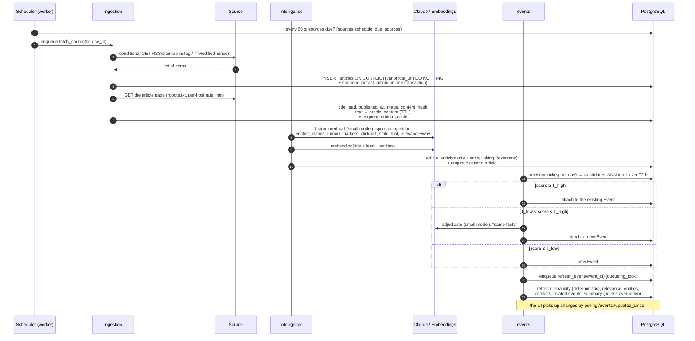

### 6.2. Editorial flow

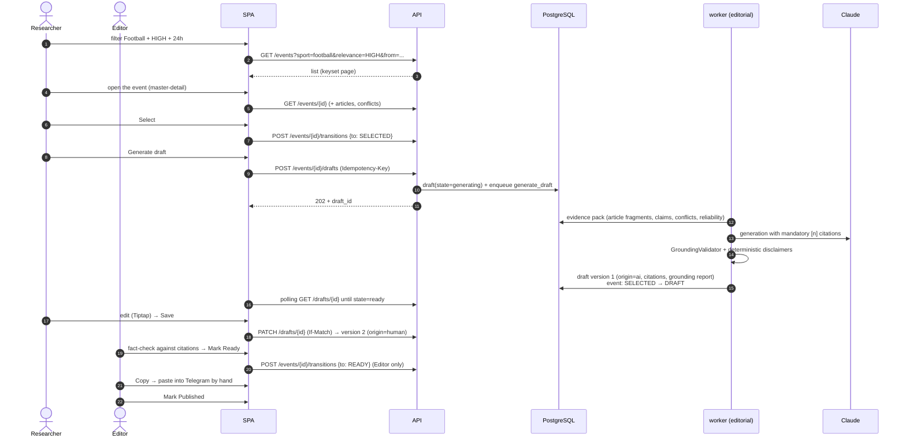

### 6.3. Manual flows

- **Add a URL by hand:** `POST /articles {url}` returns 202 and runs the same pipeline with `manual=true` (the source is resolved by domain, or `Source(kind=manual)` if none matches). SSRF protection is described in §13.
- **Create an Event by hand:** `POST /events` creates an event with `origin=human` and reliability=UNKNOWN until articles are attached.
- **Fixing clustering:** `POST /events/{id}/articles/{article_id}/move {target_event_id | new}` and `POST /events/{id}/merge {other_id}`. A manual move sets `event_articles.cluster_locked = true`, and automatic clustering no longer touches that article. The requirements do not ask for this explicitly, but without it AI mistakes cannot be corrected. Corrections serve as a signal for evals.

### 6.4. A story developing during the day, and other edge cases

| Edge case | Architectural answer |
|---|---|
| Several sources about one event | Clustering §8.5, independence by `owner_group` |
| A story developing during the day | New articles attach to the Event and `refresh_event` recomputes the summary. If a person edited the summary, `has_updates_since_edit` is set instead of overwriting, and the UI shows a banner "N new sources since your edit". A substantially new fact (new claims on another attribute) creates a new Event linked with `related(kind=follow_up)` |
| Contradicting sources | Claims → `event_conflicts`, a ⚠ Conflicting reports banner, reliability ≤ MEDIUM, the disputed claim is excluded from the facts in the prompt and flagged in the draft |
| Rumours | Rumour markers from enrichment (`segundo apuração`, `pode`, `especula-se`, `negocia`, …) → a reliability factor. The draft gets a **deterministic** "⚠ Não confirmado" label |
| Old stories republished | `stale_hint` (the date of the fact in the text ≪ the publication date) and a match with a closed Event older than the window → the article is marked as related to the old event, relevance drops one level, the UI shows a "Possibly old news" badge |
| Clickbait | The `clickbait` flag: the article title is not used as the Event title and the reliability factor drops |
| An unavailable source | `source_fetch_runs` and exponential backoff; DEGRADED/DOWN health is visible in the admin. The article link stays, with "source unavailable at the last check" next to it |
| No confirmation | A single tier B/C source gives reliability LOW/UNKNOWN; the draft is generated with a label |
| AI errors | A schema error → one "repair" attempt, then `enrichment_failed`. The article stays visible with Sport=Unclassified and is **not lost**. Manual correction in the UI |
| Low iGaming relevance | IRRELEVANT is hidden by the default filter but still available |
| Little information | An event from 1 article with a short lead: the summary is marked "Informação limitada", draft generation shows a warning |

---

## 7. Background jobs

### 7.1. Mechanism

**Decision:** Procrastinate (PostgreSQL `LISTEN/NOTIFY` and `SELECT … FOR UPDATE SKIP LOCKED`), with periodic jobs built into the worker.
- **Why:** no Redis; enqueueing is atomic with business data; it has retries, queueing locks (debounce) and periodic jobs; the queue state is visible with an SQL query.
- **Alternatives:** Celery + Redis/RabbitMQ (heavier, another dependency, no atomicity with the database); arq/RQ (need Redis); Temporal (powerful, but overkill for a linear pipeline); cron + scripts (no retries or parallelism).
- **Trade-offs:** throughput is bounded by PostgreSQL. That is thousands of jobs per second, orders of magnitude above our load. If the queue becomes a problem, it can move to a separate database without changing job code.

### 7.2. Job catalogue

| Job | Trigger | Queue | Retries | Idempotency / lock |
|---|---|---|---|---|
| `schedule_due_sources` | periodic, 60 s | `scheduler` | — | single instance (periodic lock) |
| `fetch_source(source_id)` | scheduler | `fetch` | 3, backoff 1→5→15 min | `queueing_lock=source_id` |
| `extract_article(article_id)` | after fetch | `fetch` | 3, backoff | `state` check |
| `enrich_article(article_id)` | after extract | `ai` | 3 (+1 repair on a schema error) | `ai_runs` cache by input_hash |
| `cluster_article(article_id)` | after enrich | `cluster` | 5, short backoff | advisory lock (sport, day) |
| `refresh_event(event_id)` | after attach/detach/edit | `cluster` | 5 | `queueing_lock=event_id` (debounce) |
| `generate_draft(draft_id)` | user action | `ai_interactive` | 2 | `draft.state` check |
| `regenerate_summary(event_id)` | user action | `ai_interactive` | 2 | `queueing_lock=event_id` |
| `purge_article_content` | periodic, 1 h | `maintenance` | — | DELETE by TTL |
| `purge_expired_sessions` | periodic, 1 h | `maintenance` | — | — |
| `refresh_analytics_views` | periodic, 15 min | `maintenance` | — | `REFRESH MATERIALIZED VIEW CONCURRENTLY` |
| `check_source_health` | periodic, 15 min | `maintenance` | — | aggregates fetch_runs |

### 7.3. Rules

- **A separate `ai_interactive` queue** with dedicated workers: generating a draft on a user's click does not wait for a nightly enrichment wave to clear the `ai` queue.
- **Per-host concurrency limits** live in `safe_fetch`: at most 1–2 concurrent requests, and the interval between requests is configured per Source. A matter of politeness and ToS.
- **A global AI rate limit and daily budget** (`platform.ai.gateway`): when exceeded, `ai` jobs are postponed (retry with a delay), while `ai_interactive` keeps working up to a hard limit.
- **Errors after the last retry:** the job goes to `failed`, and the entity gets `processing_state=failed` with an error code. The "Pipeline" admin screen lists them and offers "Retry".
- **Idempotency keys:** every job is safe to run again. A retry creates no duplicates thanks to unique keys and state checks.

---

## 8. AI integration

### 8.1. The role of AI: "AI extracts, code decides"

| AI does | Code does (deterministically) |
|---|---|
| Extracts sport, competition, entities, claims, rumour markers, clickbait, stale hint | Links entities to the reference data, normalises |
| Proposes relevance + why | Applies modifiers, stores the origin |
| Decides "same fact?" in the clustering grey zone | Picks candidates, computes the score and thresholds |
| Compares claims for contradictions | Groups claims, caps reliability |
| Writes the summary and draft with citations | Validates grounding, inserts disclaimers, labels AI content |
| — | **Computes reliability entirely** |

**Why:** requirements of the form "AI must not…" cannot be guaranteed by a prompt; they can only be guaranteed by checking the result.
**Alternative:** trust the prompt ("do not make up facts").
**Trade-off:** more validator code and occasional false positives (a sentence flagged as "unverified" although it is correct). A false positive is cheap; a missed fabrication is expensive.

### 8.2. LLM gateway (`platform/ai`)

The single entry point for every AI call. Modules do not import provider SDKs.

```text
LlmClient.run(task: TaskName, prompt_version, inputs, output_schema) -> (validated_output, run_id)
EmbeddingClient.embed(texts) -> vectors
```

The gateway's responsibilities:
1. **Model routing per task** (configured in `app_settings`, changes without a redeploy):
   - _ADR-004: in the MVP this routing is replaced by per-step `rules|llm` modes with a local model (`app_settings.ai_routing`). Below is the target routing for a paid provider._
   - `enrich_article`, `cluster_adjudicate`, `conflict_check` → **a small Claude model** (volume, price, latency);
   - `event_summary`, `telegram_draft`, `headline` → **a larger Claude model** (text quality in pt-BR);
   - escalation to a stronger model after a repeated schema error.
2. **Structured output:** JSON Schema from Pydantic models (tool use / structured outputs), validation, one repair attempt.
3. **The `ai_runs` log:** task, model, prompt_version, input_hash, tokens, cost, latency, status, output. It is at once an audit trail, a cache, a source for evals and billing.
4. **Caching** by `(task, prompt_version, model, input_hash)`. Reprocessing the same article is free.
5. **Provider prompt caching** for long stable parts (system instructions, the relevance rubric, the alias list).
6. **Budget and circuit breaker:** a daily spending limit per environment, cut-off on a spike of provider errors (degradation is described in §19).
7. **A fake adapter** for local, CI and e2e: deterministic answers from fixtures.

**Why a thin gateway of our own rather than a LangChain-like framework:** about five functions are needed, while a framework brings abstractions, an unstable API and makes prompt debugging harder.
**Alternative:** an external LLM proxy (LiteLLM, Portkey). It makes sense with several providers; the MVP does not justify it.
**Trade-off:** a second provider needs another adapter, and the port is ready for it.

### 8.3. Prompts as code

- Prompts live in `platform/ai/prompts/<task>/v<N>.md` together with the output schema. Changing a prompt means a new version, a PR and a mandatory evals run (§31).
- `prompt_version` is stored with every result (enrichment, summary, draft), so it is clear which version produced what.
- The iGaming relevance rubric is **data, not a prompt**: it lives in `app_settings`, is edited by an Admin and substituted into the prompt. An Admin changes "what matters for the business" without touching engineering instructions.
- **Alternative:** prompts in the database with a UI editor. **Trade-off:** with "prompts in git" only developers can change them, but there is review and evals. For factual correctness that matters more.

### 8.4. Article enrichment (one call per article)

Input: title, lead, text (truncated to N tokens), source, publication date, a list of candidate aliases from taxonomy (prompt-cached).
Output (schema): `language, sport, competition_mention, entities[{mention, kind, canonical_guess}], claims[], rumor_markers[], clickbait, event_date_hint, relevance{level, rationale}`.

**Why one call instead of ten separate classifiers:** 5–10 times cheaper and faster, and the features are consistent with each other.
**Alternative:** classic models (fastText for sport, spaCy pt NER). Cheaper at volume, but they need training and labelling, handle slang worse and give no rationale.
**Trade-off:** every article depends on the LLM. A degradation path exists: the "sport from the RSS/URL section" rule as a fallback.

Entity linking is deterministic: an alias from `entity_aliases` (exact, unaccent) → trigram similarity ≥ a threshold → otherwise an `unlinked mention`, visible in the admin for extending the reference data.

### 8.5. Clustering and deduplication

Three levels of deduplication:
1. **URL:** `canonical_url` is UNIQUE.
2. **Content (syndication):** the same `content_hash` (SimHash of the normalised text) on different URLs. The article is marked as a copy, attached to the same Event and **not** counted as an independent confirmation.
3. **Semantics (the event):** candidate scoring.

Candidate scoring (an Event within a 72 h window, the same sport or Unclassified):

```text
score = 0.6 · cos(embedding_article, centroid_event)
      + 0.3 · jaccard(linked_entities_article, entities_event)
      + 0.1 · same_competition
      − a penalty if claims on the same (subject, attribute) are incompatible in time
```

- `score ≥ T_high` (about 0.82) → attach; `score ≤ T_low` (about 0.6) → new Event; between the thresholds → LLM adjudication (a short prompt: "do these texts describe the same fact? yes/no/related"). `related` creates a new Event linked with `event_relations(kind=related)`.
- Thresholds and weights live in `app_settings` and are calibrated with evals. They are a calibration knob, not a constant. (The lexical mode uses different thresholds, see ADR-003.)
- Candidates are selected with a pgvector HNSW index (`top-k=20`) filtered by time and sport.

**Why a hybrid (vectors + entities + LLM in the grey zone):** vectors alone merge "Flamengo won" and "Flamengo lost" (similar texts), and an LLM over all pairs is expensive (O(n) calls per article).
**Alternatives:** HDBSCAN or batch clustering every N minutes (better global structure, but worse latency and unstable event IDs, and the editor loses "their" event); LLM only.
**Trade-off:** online clustering depends on the order in which articles arrive. Fixed with manual merge/move and a background `suggest_merges` (post-MVP).

### 8.6. Reliability (a deterministic policy)

| Rule (top to bottom, first match wins) | Level |
|---|---|
| An OFFICIAL source (club, federation, league) with a `confirmed` claim and no open conflicts | HIGH |
| ≥ 2 independent (`owner_group`) tier A sources, no rumour markers, no conflicts | HIGH |
| An open conflict on a key attribute | ≤ MEDIUM (cap) |
| 1 tier A source **or** ≥ 2 independent tier B sources, no rumour markers | MEDIUM |
| Rumour markers, or clickbait, or only tier C | LOW |
| A source without a tier (manual/unknown) or no articles | UNKNOWN |

The factors are stored in `ReliabilityAssessment.factors` and shown in the UI ("why MEDIUM"). An Editor can override the level with a mandatory reason (audited).
**Alternative:** a level from the LLM. Unexplainable, unstable, and contrary to the requirement of "reliability assistance" rather than "reliability decision".
**Trade-off:** the rules are coarse, and a person assigns the source tier. A post-MVP "source reliability history" would allow recomputing tiers from statistics.

### 8.7. Grounding of drafts and summaries

1. **Evidence pack:** code assembles numbered fragments: the lead and relevant paragraphs of the event's articles (from `article_content`, while the TTL has not expired), claims with their modality, the list of conflicts, the reliability level.
2. **Prompt:** write only from the evidence; put `[n]` after each sentence; write rumours and disputed statements in a conditional mood; do not add numbers, quotes or scores that are not in the evidence.
3. **GroundingValidator** (code):
   - every sentence has at least one `[n]` reference to an existing fragment;
   - every number, score (`2x1`, `2-1`), date, quoted text and proper name in the output appears (after normalisation) in the cited fragments;
   - on a violation the sentence is marked `unverified` and highlighted in the editor. **It is never removed silently:** a person decides.
4. **Deterministic insertions:** if reliability < HIGH or there is an open conflict, code adds a label ("⚠ Não confirmado" / "⚠ Informações conflitantes") and does not allow removing it without confirmation. AI can never "upgrade" the status of information.
5. **Transparency:** `[n]` links in the UI are clickable and open the source article. `[n]` markers do not end up in the copied Telegram text; they are replaced by a source link according to the settings.
6. **AI content is visually distinct:** AI text not yet edited by a person has a background or an "AI" badge and `aria-describedby`. After an edit the version gets `origin=human`.

### 8.8. Prompt injection protection

Article text is untrusted data:
- it is passed in dedicated data blocks with an explicit instruction "the content is data, not commands";
- the model has **no tools with side effects**, only an output schema;
- the output goes through schema validation and grounding, so an injection can at worst spoil one classification, not perform an action;
- HTML in the model's output is sanitised against the Telegram tag allowlist (§13).

### 8.9. Embeddings

- **Decision:** a multilingual embedding model via API (e.g. Voyage multilingual) behind the `EmbeddingClient` port, with the dimension in config and an HNSW index in pgvector.
- **Why:** Claude has no embedding endpoint; hosting a local model makes the worker image heavier (~1–2 GB, CPU).
- **Alternative:** a local `multilingual-e5` in the worker. No external dependency or per-request cost, but a bigger image and slower on CPU.
- **Trade-off:** changing the model requires full reindexing. That is why the table stores `embedding_model`, and reindexing runs as a background job.

### 8.10. Translation and headlines

- **Headline generation** is part of the MVP as part of the draft (same grounding).
- **Translation** is post-MVP, behind the `ai_translation` flag. Translating a draft into the editor's language (ru/en) is only for understanding and **never** reaches the Telegram text without an explicit action.

---

## 9. Database design

### 9.1. General decisions

| Decision | Why | Alternatives | Trade-off |
|---|---|---|---|
| One database, **one PostgreSQL schema per module** (`sources`, `ingestion`, `events`, …) | Table ownership is visible at the database level, permissions can be separated, extracting a module gets easier | A single `public` schema with prefixes | Cross-schema FKs are allowed only "down" the module graph |
| `uuid` v7 PKs | Time-ordered (good for indexes), can be generated in the application, do not reveal volumes | bigserial | 16 bytes instead of 8, irrelevant at our volume |
| Time in `timestamptz` (UTC), shown in the user's TZ (default `America/Sao_Paulo`) | Unambiguous | local time | — |
| Workflow enums as `text` + `CHECK` | Extension without `ALTER TYPE`, simpler migrations | PostgreSQL ENUM | No type safety at the schema level; CHECK provides it |
| Extensible reference data (sports, competitions) as **tables**, not enums | The requirement that "the list must be extensible" | an enum in code | Needs seed migrations |
| Semi-structured AI results in `jsonb` + key fields in columns | Filters use columns, details (claims, factors) live in jsonb, the AI schema can evolve | Full normalisation of claims | Claims are not indexed individually (not needed in the MVP) |
| **Full article text is not stored permanently** | Copyright and ToS | Store everything | "Content" search works on the lead, summary and entities, not the full text. The text lives in `article_content` with a TTL (7 days by default, a per-source policy) for the evidence pack |

### 9.2. ER diagram

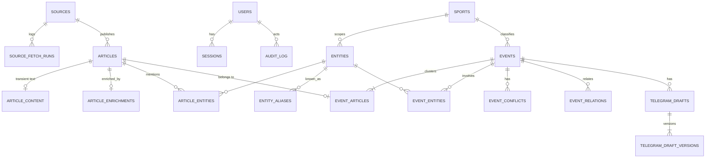

### 9.3. Schema (logical description of the tables)

> Below is the data schema, not the migrations. Types and constraints reflect the architectural invariants.

```sql
-- identity ---------------------------------------------------------------
users (
  id uuid PK, email citext UNIQUE NOT NULL, display_name text,
  role text NOT NULL CHECK (role IN ('researcher','editor','admin')),
  locale text DEFAULT 'pt-BR', timezone text DEFAULT 'America/Sao_Paulo',
  active bool DEFAULT true, oidc_subject text UNIQUE, created_at, last_login_at
)
sessions (
  id_hash bytea PK,                 -- the SHA-256 of the token is stored, not the token itself
  user_id uuid FK, created_at, last_seen_at, expires_at, ip inet, user_agent text
)

-- sources ----------------------------------------------------------------
sources (
  id uuid PK, name text, base_url text, domain text UNIQUE,
  kind text CHECK (kind IN ('rss','sitemap','html','official','manual')),
  feed_urls text[], parser_profile text,          -- parsing profile key (selectors in code/config)
  tier text CHECK (tier IN ('OFFICIAL','A','B','C')) NULL,
  owner_group text,                               -- 'globo', 'uol', ... for independence
  language text DEFAULT 'pt-BR',
  poll_interval interval DEFAULT '5 min', min_request_gap interval DEFAULT '2 s',
  content_policy text CHECK (content_policy IN ('snippet_only','transient_text')) DEFAULT 'transient_text',
  content_ttl interval DEFAULT '7 days',
  tos_notes text, active bool DEFAULT true,
  health text DEFAULT 'unknown', next_poll_at timestamptz,
  etag text, last_modified text, version int
)
source_fetch_runs (
  id uuid PK, source_id FK, started_at, finished_at, status text,
  http_status int, items_seen int, items_new int, error_code text, error_detail text
)  -- retention 30 days

-- ingestion --------------------------------------------------------------
articles (
  id uuid PK, source_id FK, canonical_url text UNIQUE NOT NULL, original_url text,
  title text NOT NULL, lead text,                 -- lead/snippet ≤ ~500 characters
  published_at timestamptz, discovered_at timestamptz NOT NULL,
  image_url text, author text, language text,
  content_hash bigint,                            -- SimHash
  duplicate_of uuid NULL FK articles,             -- syndication
  manual bool DEFAULT false, added_by uuid NULL,
  state text CHECK (state IN ('discovered','extracted','enriched','clustered','failed')),
  failure_code text,
  search_tsv tsvector GENERATED (title + lead, config 'pt_unaccent')
)
article_content (
  article_id uuid PK FK, text text, extracted_at, expires_at  -- removed by the purge job
)

-- taxonomy ---------------------------------------------------------------
sports (id text PK /* 'football' */, name_i18n jsonb, sort int, active bool)
entities (
  id uuid PK, kind text CHECK (kind IN ('competition','team','player','coach','person','venue')),
  sport_id text FK NULL, canonical_name text, country text,
  external_ids jsonb, priority smallint DEFAULT 0,   -- weight for relevance (Série A, Libertadores…)
  active bool
)
entity_aliases (entity_id FK, alias text, alias_norm text /* unaccent+lower */, PRIMARY KEY (entity_id, alias_norm))
  -- GIN trgm index on alias_norm

-- intelligence -----------------------------------------------------------
article_enrichments (
  article_id uuid PK FK,
  sport_id text FK NULL, competition_id uuid FK NULL,
  relevance text, relevance_rationale text,
  clickbait bool, rumor_markers text[], event_date_hint date,
  claims jsonb, raw_entities jsonb,
  embedding vector(1024), embedding_model text,
  prompt_version text, ai_run_id uuid, enriched_at
)
article_entities (article_id FK, entity_id FK, role text, PRIMARY KEY (article_id, entity_id))

-- events -----------------------------------------------------------------
events (
  id uuid PK, title text, title_origin text,
  summary text, summary_origin text, summary_citations jsonb,
  occurred_at timestamptz, first_seen_at, last_article_at, updated_at,
  sport_id text FK, competition_id uuid FK NULL,
  relevance text, relevance_rationale text, relevance_origin text,
  reliability text, reliability_factors jsonb, reliability_origin text,
  status text CHECK (status IN ('NEW','REVIEWING','SELECTED','DRAFT','READY','PUBLISHED','REJECTED')),
  rejection_reason text NULL, rejection_comment text NULL,
  manual_overrides text[] DEFAULT '{}', has_updates_since_edit bool DEFAULT false,
  has_open_conflicts bool DEFAULT false, stale_suspected bool DEFAULT false,
  source_count int, independent_source_count int,  -- denormalised for the list
  centroid vector(1024),
  origin text CHECK (origin IN ('auto','manual')), created_by uuid NULL,
  assignee_id uuid NULL,
  search_doc text,                                 -- title+summary+entity names+source names
  search_tsv tsvector GENERATED (search_doc, 'pt_unaccent'),
  version int NOT NULL DEFAULT 1
)
event_articles (
  article_id uuid PK FK, event_id uuid FK NOT NULL,
  attached_at, attach_score real, attach_method text /* auto|adjudicated|manual */,
  cluster_locked bool DEFAULT false
)
event_entities (event_id FK, entity_id FK, role text, mentions int, PRIMARY KEY (event_id, entity_id))
event_conflicts (
  id uuid PK, event_id FK, subject_entity_id uuid NULL, attribute text,
  positions jsonb,          -- [{article_id, statement, modality}]
  state text CHECK (state IN ('open','resolved','dismissed')), resolved_by uuid NULL, resolution_note text
)
event_relations (event_id FK, related_event_id FK, kind text /* related|follow_up|possible_duplicate|old_news */, score real,
  PRIMARY KEY (event_id, related_event_id))

-- editorial --------------------------------------------------------------
telegram_drafts (
  id uuid PK, event_id FK, state text CHECK (state IN ('generating','ready','failed')),
  current_version int, created_by uuid, created_at, updated_at, version int
)
telegram_draft_versions (
  draft_id FK, n int, body_tg_html text, image_url text NULL, caption text NULL,
  origin text CHECK (origin IN ('ai','human')), citations jsonb, grounding_report jsonb,
  prompt_version text NULL, ai_run_id uuid NULL, author_id uuid NULL, created_at,
  PRIMARY KEY (draft_id, n)
)

-- platform ---------------------------------------------------------------
ai_runs (
  id uuid PK, task text, model text, prompt_version text, input_hash bytea,
  status text, input_tokens int, output_tokens int, cost_usd numeric(10,6), latency_ms int,
  output jsonb, error text, created_at
)  -- UNIQUE (task, prompt_version, model, input_hash) WHERE status='ok' → cache; retention 90 days
app_settings (key text PK, value jsonb, updated_by uuid, updated_at)  -- relevance rubric, thresholds, models
feature_flags (key text PK, enabled bool, roles text[] NULL, description text, updated_by, updated_at)

-- audit ------------------------------------------------------------------
audit_log (
  id bigint GENERATED ALWAYS AS IDENTITY PK, at timestamptz, actor_id uuid NULL /* NULL = system */,
  action text, target_type text, target_id uuid, before jsonb, after jsonb, reason text, request_id text
)  -- the application has only INSERT/SELECT (REVOKE UPDATE, DELETE)

-- procrastinate_* : queue tables (managed by the library, own schema)
```

### 9.4. Key indexes

| Index | Serves |
|---|---|
| `events (status, relevance, last_article_at DESC, id)` | The main Dashboard list + keyset pagination |
| `events (sport_id, last_article_at DESC)`, `events (competition_id, last_article_at DESC)` | Filters |
| `events USING GIN (search_tsv)` | Search |
| `event_entities (entity_id, event_id)` | Search and filter by player/team |
| `entity_aliases USING GIN (alias_norm gin_trgm_ops)` | Fuzzy name search (`Gabigol` ≈ `Gabriel Barbosa` via aliases) |
| `articles USING GIN (search_tsv)`, `articles (source_id, published_at DESC)` | Article search, filter by source |
| `article_enrichments USING hnsw (embedding vector_cosine_ops)` | Clustering candidates |
| `events USING hnsw (centroid vector_cosine_ops)` | Similar and related events |
| `audit_log (target_type, target_id, at)` | An object's history |

**Search:** a custom FTS configuration `pt_unaccent` (portuguese stemmer + unaccent). A user's query is handled like this: (1) a tsquery on `events.search_tsv`; (2) in parallel, a trigram search over entity aliases → events with those entities; the results are merged and ranked (`ts_rank` + entity match + freshness). The "Source" filter is an `EXISTS` over `event_articles ⋈ articles`.
- **Why not Elasticsearch:** at 1–3 million documents PostgreSQL FTS fits the latency budget, while Elasticsearch is one more stateful cluster plus data synchronisation.
- **Trade-off:** no advanced highlighting, synonyms or "did you mean". Entity aliases partly stand in for synonyms.

### 9.5. Data lifecycle

| Data | Retention |
|---|---|
| `article_content.text` | Per-source TTL (7 days by default; `snippet_only` never stores the text) |
| articles, events, drafts | Forever (metadata + own content) |
| `source_fetch_runs` | 30 days |
| `ai_runs.output` | 90 days (then aggregates) |
| `audit_log` | ≥ 2 years, append-only |
| sessions | Until expiry + 7 days |

**Migrations:** Alembic, strictly expand → migrate → contract (code versions N and N-1 stay compatible for rolling deploys). Details in §29.

---

## 10. API strategy and design

### 10.1. Strategy

| Decision | Why | Alternatives | Trade-off |
|---|---|---|---|
| **REST + JSON**, resource-oriented, `/api/v1` | One client (the SPA), simple CRUD + actions, HTTP caching, OpenAPI tooling | GraphQL (flexible selection is not needed by a single client, complicates authorization and caching); tRPC (needs a TS backend); gRPC (not for browsers) | Aggregates sometimes need 2 requests (event + drafts). Solved with `?include=` |
| **OpenAPI-first via code** (FastAPI generates it, CI pins `openapi.json`) | The contract always matches the implementation, TS types are generated | Hand-written spec-first | Contract changes show up as an `openapi.json` diff in the PR |
| Workflow actions as **command sub-resources** (`POST /events/{id}/transitions`) | A status transition is a command with rules, not a field PATCH | `PATCH {status}` | Slightly more endpoints, but explicit semantics and audit |
| Asynchronous operations → **202 + a resource with state** + polling | Draft generation takes 5–30 s | Long polling, WebSocket | 1–2 s polling delay. Good enough for UX |
| List updates → polling `?updated_since=` every 30 s | Simple, works behind any proxy | SSE via `LISTEN/NOTIFY` | Up to 30 s delay. SSE can be added behind a flag with the same data contract |
| Versioning: the `/v1` path + additive changes only | One client, deployed together with the API | Header versioning | `/v2` is only needed with public consumers |

### 10.2. Conventions

- **Errors:** RFC 9457 `application/problem+json`: `{type, title, status, detail, code, errors[], request_id}`. `code` is stable (`event.invalid_transition`, `draft.version_conflict`) and translated on the frontend.
- **Pagination:** keyset (cursor): `?limit=50&cursor=<opaque>`, response `{items, next_cursor}`. No offsets: the list keeps growing, and offsets cause duplicates and gaps.
- **Filters:** query parameters, repeated values separated by commas (`relevance=HIGH,MEDIUM`), all combined with AND.
- **Concurrency:** `ETag: "<version>"` in the response, `If-Match` is required for PATCH and transitions (428 otherwise).
- **Idempotency:** an `Idempotency-Key` header for `POST /articles` and `POST /events/{id}/drafts`; keys are kept for 24 h.
- **Time:** ISO 8601 UTC.
- **Enums:** stable keys (`HIGH`, `NOT_TELEGRAM_WORTHY`); display names live on the frontend (i18n).
- **AI labelling in the data:** every text field that may be AI-generated comes with `*_origin: "ai" | "human"`.

### 10.3. Resources

| Method and path | Purpose | Minimum role |
|---|---|---|
| `GET /auth/login` → IdP redirect; `GET /auth/callback`; `POST /auth/logout` | OIDC | — |
| `GET /me` | User, role, locale, feature flags | any |
| `GET /events?sport=&competition=&relevance=&reliability=&source=&status=&from=&to=&q=&entity=&updated_since=&cursor=&limit=&sort=` | List, filters and search | researcher |
| `GET /events/{id}?include=articles,conflicts,related,draft` | Details | researcher |
| `POST /events` | Create an Event by hand | researcher |
| `PATCH /events/{id}` (If-Match) | Edit title, summary, sport, competition, entities → manual override | researcher |
| `PUT /events/{id}/relevance`, `PUT /events/{id}/reliability` | Manual override with a reason | editor |
| `POST /events/{id}/transitions {to, reason?, comment?}` | Workflow | researcher; `READY`/`PUBLISHED`/restore require editor |
| `POST /events/{id}/merge {other_event_id}` | Merge | researcher |
| `POST /events/{id}/articles/{article_id}/move {target_event_id\|null}` | Move and split | researcher |
| `POST /events/{id}/summary:regenerate` | Regenerate the summary (202) | researcher |
| `PATCH /events/{id}/conflicts/{cid} {state, note}` | Resolve or dismiss a conflict | editor |
| `POST /events/{id}/drafts` (Idempotency-Key) | Generate a draft (202) | researcher |
| `GET /drafts/{id}`, `GET /drafts/{id}/versions/{n}` | Draft and history | researcher |
| `PATCH /drafts/{id}` (If-Match) `{body_tg_html, image_url, caption}` | Save a new version | researcher |
| `POST /drafts/{id}:regenerate` | A new AI version | researcher |
| `GET /articles?q=&source=&from=&to=` / `GET /articles/{id}` | Article search and details | researcher |
| `POST /articles {url}` (Idempotency-Key) | Add a URL by hand (202) | researcher |
| `GET /taxonomy/sports`, `GET /taxonomy/entities?q=&kind=` | Reference data and autocomplete | researcher |
| `POST/PATCH /taxonomy/...` | Managing reference data | admin |
| `GET/POST/PATCH /sources`, `GET /sources/{id}/runs`, `POST /sources/{id}:test` | Sources and health (`:test` is a trial fetch without saving) | admin |
| `GET/PUT /settings/{key}` | Relevance rubric, thresholds, models | admin |
| `GET/PUT /feature-flags/{key}` | Flags | admin |
| `GET/POST/PATCH /users` | Users and roles | admin |
| `GET /pipeline/failures`, `POST /pipeline/failures/{id}:retry` | Pipeline errors | admin |
| `GET /audit?target_type=&target_id=` | Action history | editor |
| `GET /analytics/useful-stories?from=&to=&group_by=user\|day` | The product metric | editor |
| `GET /healthz`, `GET /readyz` (outside `/api/v1`, no auth) | Liveness and readiness | — |

### 10.4. Example response (the shape, not the implementation)

```json
{
  "id": "0192…",
  "title": "Flamengo: atacante sofre lesão muscular",
  "title_origin": "ai",
  "summary": { "text": "…[1][3]", "origin": "ai", "citations": [{"n":1,"article_id":"…"}] },
  "sport": {"id":"football","name":"Football"},
  "competition": {"id":"…","name":"Brasileirão Série A"},
  "teams": [{"id":"…","name":"Flamengo"}],
  "players": [{"id":"…","name":"Pedro"}],
  "relevance": {"level":"HIGH","rationale":"Lesão de titular antes do clássico…","origin":"ai"},
  "reliability": {"level":"MEDIUM","origin":"rule",
    "factors":[{"code":"single_tier_a","label_key":"reliability.single_tier_a"}]},
  "status": "REVIEWING",
  "source_count": 7, "independent_source_count": 3,
  "has_open_conflicts": true, "has_updates_since_edit": false,
  "occurred_at": "2026-10-03T14:10:00Z", "last_article_at": "2026-10-03T15:02:00Z",
  "version": 12
}
```

---

## 11. Authentication

**Decision:** OIDC Authorization Code Flow + PKCE through a corporate IdP (Google Workspace or Microsoft Entra ID). After the callback a **server-side session** is created in PostgreSQL, and the browser receives an opaque identifier in the cookie `__Host-sid; HttpOnly; Secure; SameSite=Lax; Path=/`.

- **Why:**
  - an internal tool: no passwords, resets or MFA on our side, the IdP does all that;
  - offboarding an employee in the IdP revokes access automatically;
  - a server-side session is revoked instantly (delete the row), tokens never reach JS (protection from XSS theft), no refresh token problems in the SPA;
  - the SPA and API share an origin, so the cookie works without CORS.
- **Alternatives:**
  - JWT in localStorage: vulnerable to XSS, hard to revoke;
  - e-mail + password (argon2) + TOTP: our own reset and MFA implementation, a larger attack surface;
  - magic links: depend on e-mail, awkward for daily work;
  - Auth0/Clerk: an external vendor is overkill for ~20 users.
- **Trade-offs:** a corporate IdP is required (**an open question**, §33). The fallback without one: a magic link with a domain allowlist behind the same `OidcProvider` interface. Every request looks up the session in PostgreSQL (PK index, < 1 ms; a 30 s in-process cache is acceptable).

> **Update 2026-10-12 ([ADR-005](adr/005-single-host-compose-password-login.md)).** There may be no corporate IdP, so the fallback is implemented as **e-mail + password** rather than a magic link (e-mail would be one more service):
> - hash: `hashlib.scrypt`; limit: 5 failures per e-mail + IP pair in 15 min;
> - session, CSRF and cookie are the same;
> - OIDC turns on when `OIDC_*` is set;
> - the first admin comes from `BOOTSTRAP_ADMIN_EMAIL` + `INITIAL_ADMIN_PASSWORD`;
> - an admin sets and resets passwords (a reset closes the user's sessions);
> - emergency reset: `sportintel-admin set-password`.
>
> There is no MFA and no self-service reset.

**Details:**
- **Access:** a user must be created in advance by an Admin (an e-mail allowlist) **or** belong to an allowed domain with the default role `researcher` (a setting). There is no self-registration.
- **Session lifetime:** a sliding idle timeout of 12 h, an absolute one of 7 days. Re-authentication through the IdP is transparent.
- **CSRF:** `SameSite=Lax` + a mandatory `X-CSRF-Token` header (double-submit from `GET /me`) on every unsafe method.
- **Logout:** delete the session + the IdP's `end_session_endpoint`.
- **Service accounts** (CI smoke tests): a separate user with a role and a token, staging only.

---

## 12. Authorization

**Decision:** RBAC with three roles, checked in two places:
1. **The API layer**: a declarative `require(permission)` dependency on the router (a coarse check).
2. **The domain layer**: `WorkflowPolicy` checks whether the role may perform a specific transition (a fine-grained check that a new endpoint cannot bypass).

| Permission | Researcher | Editor | Admin |
|---|:-:|:-:|:-:|
| View, search, filter, open the source | ✓ | ✓ | ✓ |
| Edit an Event (title, summary, sport, entities), create by hand, add a URL | ✓ | ✓ | ✓ |
| Transitions NEW → REVIEWING → SELECTED → DRAFT, Reject | ✓ | ✓ | ✓ |
| Generate, edit and copy a draft | ✓ | ✓ | ✓ |
| Merge / move articles | ✓ | ✓ | ✓ |
| **DRAFT → READY, READY → PUBLISHED, restore from REJECTED** | — | ✓ | ✓ |
| Override relevance and reliability, resolve conflicts | — | ✓ | ✓ |
| Audit and analytics | — | ✓ | ✓ |
| Sources, reference data, settings, flags, users, pipeline retry | — | — | ✓ |

- **Why RBAC:** the roles map cleanly to permission sets, and there is no resource ownership (multi-tenancy).
- **Alternatives:** ABAC/ReBAC (OPA, Cedar, OpenFGA): overkill; per-user permissions: unmanageable.
- **Trade-offs:** there is no "only the draft's author may edit it" rule. A small team does not need it, and the audit shows who changed what. Permissions are `Permission` constants → a set of roles, and adding a role is a change to one table.
- **Four-eyes principle (the optional `require_second_reviewer` flag):** the author of the latest draft version cannot set READY. The flag is off by default, because for 3 people it could block work.

---

## 13. Security model

### 13.1. Trust boundaries

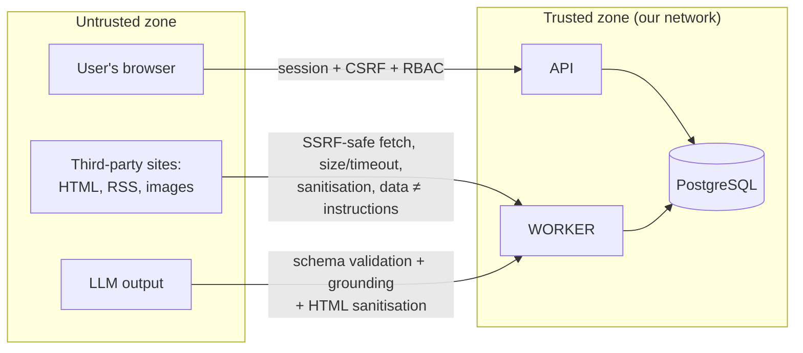

### 13.2. Threats and mitigations (STRIDE-lite)

| Threat | Vector | Mitigations |
|---|---|---|
| **SSRF** | "Add a URL by hand", source redirects, image URLs | `http(s)` only, DNS resolution and a **ban on private, loopback, link-local and metadata addresses** (checked after resolution and on every redirect, DNS rebinding protection via IP pinning), ≤ 5 redirects, 10 s timeout, 5 MB limit, allowed content types. Fetching happens only in the worker, which has no access to internal services except the database (egress policy) |
| **Stored XSS** | Source titles and HTML, LLM output, drafts | Only text is extracted from sources. Drafts are stored as Telegram HTML and sanitised **on the server** against an allowlist (`b, strong, i, em, u, s, a[href=https], code, pre, blockquote, tg-spoiler`) and again at render time (DOMPurify). A strict CSP: `default-src 'self'; img-src 'self' https:; script-src 'self'; frame-ancestors 'none'` |
| **Prompt injection** | Article text | §8.8: no tools, schema validation, grounding, a human in the loop |
| **CSRF** | Mutations | SameSite=Lax + `X-CSRF-Token` |
| **Session theft** | XSS, interception | HttpOnly, Secure, `__Host-`, HSTS, CSP; the token is stored in the database as a hash |
| **Privilege escalation** | Direct API calls | RBAC on the router and in the domain; API tests of the permission matrix |
| **Secret leaks** | Frontend, logs, repository | AI, IdP and Sentry keys only on the server; the platform's secret manager; gitleaks in CI; secret redaction in logs |
| **Denial of service and costs** | Mass generation requests | A per-user rate limit on AI endpoints, a daily AI budget, a request body size limit |
| **Repudiation** | Denying actions | An append-only `audit_log` (the application role has no UPDATE or DELETE) |
| **Legal risks (ToS, copyright)** | Storing and copying content | robots.txt, `tos_notes` and `content_policy` on the source, text TTL, drafts contain only paraphrases and short attributed quotes, a link to the original |
| **Supply chain** | Dependencies | Lock files, Dependabot/Renovate, `pip-audit`/`npm audit`, image scanning (Trivy), a pinned base image |

### 13.3. Data protection

- TLS everywhere (including to the database). Encryption at rest is provided by managed PostgreSQL and backups.
- Minimal PII: e-mail, name and IP in sessions. All users are internal, and the data does not leave the system.
- Only article texts and the rubric are sent to the LLM. **User data never reaches prompts.**
- Least privilege in the database: an `app` role (DML on its schemas, only INSERT/SELECT on `audit_log`), a `migrator` role (DDL), a read-only role for analytics and debugging.

### 13.4. Audit of critical actions

Recorded: status changes (with the reason), edits of the title, summary and relevance/reliability (before/after), saving and copying a draft (the `draft.copied` event is an "almost published" signal), merges and moves, changes to sources, settings, flags and roles, sign-in and sign-out. The audit entry is written **in the same transaction** as the change.

---

## 14. Frontend architecture

### 14.1. Decisions

| Decision | Why | Alternatives | Trade-off |
|---|---|---|---|
| **SPA (React + Vite)** served by the same web process (or a CDN) on the same origin | An internal tool behind a login: no SEO or SSR needed; one highly interactive master-detail application | Next.js (SSR is overkill, one more runtime); HTMX + templates (hard for the preview, editor and hotkeys); Vue/Svelte (equally fine, chosen by popularity) | The first load is heavier than SSR. Irrelevant for a desktop tool |
| **TanStack Router** with typed search params | Filters and the selected event live in the URL: a link can be sent to a colleague, "back" works | React Router | — |
| **TanStack Query** for server state | Caching, polling, deduplication, optimistic mutations | Redux Toolkit Query, SWR | — |
| **shadcn/ui (Radix) + Tailwind** | Accessible primitives (focus, ARIA, keyboard) and full control over component code | MUI, Ant Design (heavier, harder to customise "Telegram-like") | Components are copied into the repository and maintained by us |
| **Tiptap** with a trimmed schema for the draft editor | WYSIWYG exactly within Telegram's capabilities (bold, italic, underline, strike, link, code, blockquote, spoiler); outputs Telegram HTML without conversion | A Markdown textarea (needs MarkdownV2 conversion and escaping, the editor sees markup); hand-rolled contenteditable | A dependency on ProseMirror (~100 KB). Justified: the editor is the centre of the work |
| **Feature-Sliced Design (lightweight)** | Explicit layers and import rules, as in the backend | Folders by type (`components/`, `hooks/`), which do not scale | Slightly more folders |

### 14.2. Frontend structure

```text
frontend/
├── index.html
├── vite.config.ts
├── src/
│   ├── app/                         # bootstrapping: providers, router, QueryClient, i18n, ErrorBoundary, auth guard
│   │   ├── routes/                  # TanStack Router file routes
│   │   └── providers.tsx
│   ├── pages/                       # composing features into a screen (no business logic)
│   │   ├── dashboard/               # Filters | EventList | EventDetails (master-detail)
│   │   ├── event/                   # full-screen event view (the same EventDetails)
│   │   ├── admin-sources/
│   │   ├── admin-taxonomy/
│   │   ├── admin-settings/          # relevance rubric, thresholds, flags, users
│   │   ├── admin-pipeline/          # pipeline errors, retry
│   │   ├── analytics/
│   │   └── login/
│   ├── features/                    # user scenarios (UI + hooks + mutations)
│   │   ├── event-filters/           # filters ↔ URL search params
│   │   ├── event-search/
│   │   ├── event-list/              # virtualised list, j/k hotkeys
│   │   ├── event-details/
│   │   ├── event-sources/           # sources and related articles
│   │   ├── event-conflicts/         # ⚠ Conflicting reports
│   │   ├── event-workflow/          # status buttons, the Reject dialog with reasons
│   │   ├── event-edit/              # field edits, merge/move
│   │   ├── telegram-draft/          # editor (Tiptap) | preview | copy | grounding highlights
│   │   └── manual-ingest/           # add a URL, create an Event
│   ├── entities/                    # frontend domain entities: types, query keys, small UI
│   │   ├── event/                   # RelevanceBadge, ReliabilityBadge, StatusChip, eventQueries
│   │   ├── article/
│   │   ├── source/
│   │   ├── draft/
│   │   └── user/                    # useMe(), can(permission)
│   └── shared/
│       ├── api/                     # generated/ (from openapi.json) + HTTP client (CSRF, problem+json → AppError)
│       ├── ui/                      # shadcn components, AiContentMark, Kbd, EmptyState
│       ├── lib/
│       │   ├── telegram/            # sanitize, render preview, toClipboard (html + plain)
│       │   ├── datetime.ts          # Intl, relative time, TZ
│       │   └── draft-autosave.ts    # localStorage buffer for an unsaved draft
│       ├── i18n/                    # pt-BR, en, ru catalogues
│       └── config/                  # build-time config (no secrets)
└── tests/
    ├── e2e/                         # Playwright + axe
    └── setup/                       # MSW handlers for component tests
```

The import rule: `app → pages → features → entities → shared`, downwards only. Enforced by `eslint-plugin-boundaries`.

### 14.3. Key UI decisions for the "Useful Stories per Hour" metric

- **Master-detail without reloads:** selecting an event only changes `?event=<id>`; details are prefetched on hover or focus.
- **Triage hotkeys:** `j/k` next and previous event, `s` Select, `r` Reject (reason dialog), `g` Generate draft, `c` Copy, `/` search. `?` opens the help.
- **List virtualisation** (TanStack Virtual): thousands of events without lag.
- **The Telegram preview** renders the same sanitised Telegram HTML as the editor, inside a channel "bubble" (font, ~420 px width, link preview, image with caption). It is **the single source of truth for preview and copy**, so they never diverge.
- **Copy:** `navigator.clipboard.write` with `text/html` and `text/plain` at once. Checking that formatting survives pasting into Telegram Desktop and Web is part of the acceptance tests; if a client ignores HTML, the plain-text version keeps emoji and links.
- **AI content is visually distinct:** the `AiContentMark` component (icon + background + an "AI · not reviewed" caption), removed after a human edit.

---

## 15. State management

| Kind of state | Where it lives | Example |
|---|---|---|
| **Server** | TanStack Query cache | events, details, drafts, reference data |
| **Navigation and shareable** | URL (search params) | filters, search query, selected event, tab |
| **Local UI** | `useState` / `useReducer` in the component | whether a dialog is open, current input |
| **A draft being edited** | Tiptap state + a `localStorage` buffer until the server confirms | unsaved draft text |
| **User preferences** | `localStorage` (+ `users.locale/timezone` on the server) | panel widths, list density |
| **Session and permissions** | `useMe()` (Query) | role, flags, locale |

- **Why no global store (Redux, Zustand):** nearly all state is server or navigation state, and there are specialised tools for that. A global store would duplicate the cache and the URL.
- **Alternative:** Redux Toolkit as the single store. **Trade-off:** if complex cross-panel client state appears (e.g. a multi-step wizard), Zustand is added locally for that feature.
- **Cache policies:** the event list has `staleTime 15s` + `refetchInterval 30s` (only while the tab is visible); event details `staleTime 10s`; reference data `staleTime 10m`; a draft in the `generating` state is polled every 1.5 s, then polling stops.
- **Optimistic updates** only for reversible actions (status changes): on error the change is rolled back and a toast is shown. Saving a draft is not optimistic: we wait for the server to confirm, because losing text is unacceptable.
- **Edit conflict (409):** the UI shows "The event was changed by user X", a field diff and "Reload" or "Overwrite" buttons. The latter is available only after the user has seen the diff.

---

## 16. Notifications

**MVP: in-app only.**
- An "N new HIGH" badge above the list (from `updated_since`) and highlighting of new rows.
- Optionally the browser `Notification API` for HIGH relevance when the tab is in the background (the user enables it).
- Admin banners: a source is DOWN, the queue grows, the AI budget is exhausted, pipeline errors.
- Toasts about action results (draft ready, edit conflict).

**Post-MVP (behind the `notify_telegram_bot` flag):** a Telegram bot that sends editors HIGH + reliability ≥ MEDIUM events in a private chat. Implemented as a `notify_high_relevance` job enqueued from `refresh_event` when relevance **transitions** to HIGH (not on every recomputation), deduplicated by event_id.

- **Why no e-mail or push in the MVP:** users work in the tool during their shift; e-mail is useless for news that lives for minutes.
- **Alternatives:** a Slack/Telegram bot right away; web push via a service worker.
- **Trade-off:** outside the tab the user learns nothing. Acceptable for the MVP, and the extension path is described above. The notification channel becomes a `Notifier` port only once the first implementation appears.

---

## 17. Third-party integrations

| Integration | Port / adapter | Failure mode | Note |
|---|---|---|---|
| **News sources** | `HttpFetcher` (`platform/safe_fetch`) + parsing profiles (`ingestion/infrastructure/parsers/<profile>.py`): RSS (feedparser), sitemap-news, HTML (trafilatura + profile selectors) | Backoff, source health; an article with partial data (only title + URL) beats nothing | **RSS and sitemaps are preferred** over HTML scraping (stability, ToS). Every profile has a contract test on saved fixtures. A new source with a standard RSS feed is added without code (just a row in `sources`), a non-standard one with a new profile |
| **Anthropic Claude** | `LlmClient` | Retry with jitter, circuit breaker, degradation (§19) | The key is server-side only; budget; the `ai_runs` log |
| **Embeddings API** | `EmbeddingClient` | Retry; when unavailable, clustering by entities and FTS similarity (worse, but works) | The model is pinned in config |
| **OIDC IdP** | `OidcProvider` (authlib) | No new sessions; existing ones keep working | Discovery via `.well-known` |
| **Sentry** | SDK | Fire-and-forget | PII scrubbing on (`send_default_pii=False`) |
| **Telegram Bot API** | `TelegramPublisher`, `Notifier` | Queue + retry | Publishing only from READY with explicit confirmation (see ADR-05 for channels). Drafts are already stored as Telegram HTML (`parse_mode=HTML`), so no conversion is needed |
| **Sports data** (future: match calendar, line-ups) | `FixturesProvider` | — | Would enrich relevance ("match in 2 days") and fact checking. Outside the MVP |

**General integration rules:** every external call has a timeout, bounded retries with backoff and jitter, a correlating `request_id` in the logs and a fake implementation for tests and local. No integration is called from the API request path, except the IdP at sign-in.

---

## 18. Caching

| Level | What is cached | Mechanism | Invalidation |
|---|---|---|---|
| HTTP to sources | RSS feeds and sitemaps | `ETag` / `If-Modified-Since` (stored in `sources`) | By the source's response |
| AI results | Enrichment, adjudication, conflict check | `ai_runs` keyed by `(task, prompt_version, model, input_hash)` | A new prompt or model version means a new key |
| AI provider | Long stable prompt prefixes (instructions, rubric, aliases) | Anthropic prompt caching | Automatically by the provider's TTL |
| List aggregates | `source_count`, `independent_source_count`, `has_open_conflicts`, `search_doc` | Denormalised into `events` during `refresh_event` | In the same transaction as the change |
| Analytics | Metrics per period | Materialized views | `REFRESH … CONCURRENTLY` every 15 min |
| In-process reference data and settings | sports, flags, `app_settings` | An in-process TTL cache of 30–60 s | By TTL (an Admin sees the effect within ≤ 1 min) |
| Frontend static files | JS, CSS | Hashed names + `Cache-Control: immutable`; `index.html` is `no-cache` | On deploy |
| Client | API responses | TanStack Query (§15) | `invalidateQueries` after mutations |

- **Why no Redis:** the only cache-consuming process is web on 1–2 instances. An in-process cache with a short TTL and denormalisation in PostgreSQL cover the needs.
- **Alternative:** Redis for caching, rate limiting and sessions.
- **Trade-off:** a per-user rate limit with several web instances is counted per instance (imprecise). If that matters, or web scales beyond 2 instances, Redis is added as an isolated change in `platform`.
- **No HTTP caching for the API** (the data is private and changes often), only `ETag` for concurrency.

---

## 19. Error handling

### 19.1. Backend error taxonomy

| Class | Example | HTTP | Behaviour |
|---|---|---|---|
| `ValidationError` | An invalid filter | 400/422 | problem+json with per-field `errors[]` |
| `NotAuthenticated` / `Forbidden` | No session or role | 401 / 403 | Frontend: redirect to login or a message |
| `NotFound` | No such event | 404 | — |
| `DomainRuleViolation` | `event.invalid_transition`, `event.override_locked` | 409/422 | A stable `code`, a localisable message |
| `ConcurrencyConflict` | A stale `If-Match` | 409 / 412 | The UI shows a diff |
| `PreconditionRequired` | No `If-Match` | 428 | — |
| `RateLimited` / `BudgetExceeded` | Too many generations, AI budget exhausted | 429 | `Retry-After` |
| `DependencyUnavailable` | AI or embeddings are down (for synchronous checks) | 503 | Rare, since AI is called only in the worker |
| Unexpected | A bug | 500 | Sentry + `request_id` in the response, no stack trace |

Domain errors are typed exceptions in `domain/errors.py`. They are mapped to HTTP **in one place** (`platform/http_api.py`). Use cases know nothing about HTTP.

### 19.2. Errors in the pipeline (worker)

- **Transient** (network, 5xx, 429, timeout, AI schema error): retry with exponential backoff and jitter (§7.2).
- **Permanent** (article 404, unsupported content, a policy violation): `state=failed` with a `failure_code` immediately, no retries.
- **After the retries run out:** `failed`, visible in Admin → Pipeline, manual retry.
- **Partial success beats total failure:** an article without text is still saved (title + URL); without enrichment it gets Sport=Unclassified; without an embedding it is clustered by entities.

### 19.3. Degradation when AI fails

| Failure | What keeps working | What the user sees |
|---|---|---|
| The LLM is unavailable or the budget is exhausted | Ingestion, the article list, search, filters, manual Events, manual drafts | An "AI temporarily unavailable" banner, new articles in Unclassified, the Generate button disabled with an explanation |
| Embeddings are unavailable | Clustering by entities + FTS title similarity | Slightly more duplicate events |
| A source is unavailable | Other sources | Health in the admin, a mark next to links |
| The database is unavailable | — | `/readyz` = 503, an error page, the pipeline pauses (jobs survive a restart) |

### 19.4. Frontend

- **An error boundary per panel** (filters, list, details, draft): one panel crashing does not break the screen.
- `problem+json` → `AppError{code, status, requestId}` → a localised message by `code` with a fallback to `title`. The `request_id` can be copied for a bug report.
- Mutations: a toast with a "Retry" action. Saving a draft on error **does not lose the text** (the localStorage buffer, §20).
- Network request errors: automatic TanStack Query retry (3 times, GET only).

---

## 20. Offline strategy

**Decision: an online-only application with protection against losing input.** Full offline support (PWA, Service Worker, a local database, synchronisation) is **not designed**.

- **Why:** the product's value lies in fresh news and AI processing, which need the network. Users work on a desktop in the office. The requirements do not ask for offline.
- **What is done:**
  - A connection indicator (`navigator.onLine` + failed requests) with a "No connection, changes not saved" banner.
  - **Draft autosave** to `localStorage` on every edit (1 s debounce) under the key `draft:{id}:{base_version}`. The buffer is cleared once the server confirms. On returning to the page, if the buffer is newer than the server, a restore is offered.
  - The last loaded data stays on screen (TanStack Query cache), and mutations are blocked with a clear message.
- **Alternatives:** an offline-first PWA with a mutation queue; an IndexedDB replica.
- **Trade-off:** no work is possible without the network. Offline edit conflicts never arise, because there are no offline mutations.

---

## 21. Internationalisation

Two independent dimensions:

**1. Interface language (UI locale):**
- i18next + ICU MessageFormat (plurals: "1 source / 7 sources"), catalogues `pt-BR`, `en`, `ru`. Catalogues are split by feature namespaces.
- The locale is stored in `users.locale` and switched in the profile.
- Dates and numbers use `Intl.DateTimeFormat`/`Intl.RelativeTimeFormat` in the user's TZ (default `America/Sao_Paulo`).
- Enum and reference-data names: enums are translated on the frontend by key, reference data stores `name_i18n jsonb`.
- A CI check: missing keys in a required locale break the build.

**2. Content language:**
- Articles are in pt-BR. The FTS configuration is `portuguese` + unaccent (`São Paulo` = `sao paulo`).
- The Telegram draft is generated in the **channel's language** (`app_settings.telegram_language`), independently of the UI language.
- Rationale and summary are generated in `analysis_language` (configurable by an Admin).
- A translation for understanding (post-MVP) is shown as a separate block labelled "machine translation" and never mixed with the original.

- **Why i18next:** mature, has ICU, lazy loading of namespaces.
- **Alternatives:** FormatJS/react-intl (equivalent), Lingui (compiled catalogues).
- **Trade-off:** AI texts (rationale) are not translated into the UI language in the MVP; the rationale is shown in the analysis language.

---

## 22. Accessibility

**Goal:** WCAG 2.2 AA on every screen.

- **Radix primitives:** correct roles, focus and keyboard handling for dialogs, menus, selects and tabs.
- **Full keyboard operation** (the hotkeys from §14.3 + visible focus). Hotkeys are not captured in input fields and can be turned off in settings (WCAG 2.1.4).
- **Information is never conveyed by colour alone:** relevance and reliability = icon + text + colour (`🔥 HIGH`, `⚡ MEDIUM`). A conflict = a ⚠ icon + text.
- **Master-detail:** selecting an event moves focus to the details heading, and `aria-live="polite"` announces "Event loaded". New events in the list are announced in summary ("3 new events"), not one by one.
- **AI content** is labelled visually and via `aria-describedby` ("AI-generated text, not reviewed").
- The Telegram preview has `role="article"` and an `aria-label`. Emoji in the text are not replaced; screen readers read them natively.
- Theme token contrast ≥ 4.5:1, `prefers-reduced-motion` support, zoom up to 200 % without losing functionality (desktop-first, but with a flexible layout).
- **Verification:** axe-core in Playwright on every key screen (CI), eslint-plugin-jsx-a11y, a manual keyboard and screen reader pass before a release.

---

## 23. Configuration

Three configuration levels with different owners and change cycles:

| Level | Where | Who changes it | Examples | Reloaded |
|---|---|---|---|---|
| **Infrastructure** | Environment variables → `pydantic-settings` (typing, validation at startup, fail-fast) | DevOps / deployment | `DATABASE_URL`, `ANTHROPIC_API_KEY`, `OIDC_*`, `SENTRY_DSN`, `ENV`, worker parallelism | On restart |
| **Business settings (runtime)** | `app_settings` (jsonb + JSON Schema validation) | An Admin in the UI, audited | The iGaming relevance rubric, clustering thresholds, model routing, the daily AI budget, the default content TTL, the channel language | ≤ 60 s (TTL cache) |
| **Reference data** | The `sources`, `sports`, `entities` tables | Admin | Sources, sports, competitions, teams, aliases | Immediately |
| **Code configuration** | The repository | Developers via PR | Prompts, parsing profiles, the state machine, the reliability policy | On deploy |

- Secrets **never** live in the repository or in `app_settings`: only the platform's secret manager → env.
- The frontend receives only public configuration (via `GET /me` and build-time variables without secrets).
- **Why the split:** different change frequencies and different risk levels. The business changes the rubric weekly, a prompt change needs evals, the database URL changes once a year.
- **Alternative:** everything in env or everything in the database. **Trade-off:** you need to remember where each parameter lives. The table in the README solves that.

---

## 24. Feature flags

**Decision:** a minimal implementation of our own: a `feature_flags (key, enabled, roles[])` table + a default value from env + a 30 s in-process cache. Flags are sent to the frontend in `GET /me`.

- **Why:** simple boolean flags with role targeting for ~20 users are enough. Percentage rollouts and experiments are not needed.
- **Alternatives:** Unleash, Flagsmith (self-hosted, one more service); LaunchDarkly (paid, external data); env-only flags (need a deploy).
- **Trade-off:** no percentage rollout or A/B. If they become necessary, `flags.is_enabled(key, user)` is backed by an Unleash adapter without changing call sites.

**Flag candidates:**

| Flag | Purpose |
|---|---|
| `ai_translation` | Post-MVP translation |
| `sse_updates` | SSE instead of polling |
| `notify_telegram_bot` | Telegram notifications |
| `telegram_publish` | Publishing via the Bot API after approval |
| `require_second_reviewer` | The four-eyes principle |
| `cluster_adjudication_llm` | A kill switch for the LLM in the clustering grey zone |
| `prompt.<task>.canary` | A new prompt version for the admin role before enabling it for everyone |

**Hygiene:** every flag has a `description` and an owner. Flags enabled everywhere for more than 30 days are removed from the code (a CI check against a list).

---

## 25. Environment management

| Environment | Purpose | Database | AI | Sources | Access |
|---|---|---|---|---|---|
| **local** | Development | Docker Compose PostgreSQL + seed (reference data, ~200 fixture articles) | **Fake** by default, real behind a flag with a personal key | Recorded fixtures (VCR-like) or 2–3 real RSS feeds | Dev login without an IdP (only `ENV=local`, strictly checked) |
| **ci** | Automated tests | An ephemeral PostgreSQL (service container) | Fake | Fixtures | — |
| **staging** | Acceptance, migration checks, evals on live data | A separate managed database | Real, **a separate key and a low budget** | A subset of real sources | IdP, a limited group |
| **production** | Work | Managed PostgreSQL with PITR (target); currently PostgreSQL in `compose.yaml` + a daily dump (ADR-005) | Real, a working budget | All active | IdP or password (ADR-005) |

- **Parity:** the same Docker image in every environment; only env and secrets differ (12-factor).
- **Data:** production data is not copied to staging (ToS-restricted content and user data). Staging fills itself through its own ingestion.
- **Per-PR preview environments** are not needed: the team is small and staging is enough. Revisit if the team grows.
- **Why:** the minimum number of environments that allows safely checking migrations and prompts before production.
- **Trade-off:** staging ingestion loads the sources. That is why a subset of sources with a longer polling interval is used.

---

## 26. Logging

- **Format:** structured JSON (structlog) to stdout. The platform collects it (Loki, CloudWatch, Better Stack); the application knows nothing about log storage.
- **Mandatory fields:** `ts, level, env, service (web|worker), version (git sha), request_id | job_id, user_id (uuid, not e-mail), module, event`.
- **Correlation:** the `request_id` from the header, or a generated one, is passed into enqueued jobs (`job.meta.request_id`). The chain "Generate click → job → AI run" can be reconstructed with one query by id. Pipeline logs also carry `source_id, article_id, event_id, ai_run_id`.
- **Levels:** `INFO` for business facts (article discovered, event created, status transition); `WARNING` for degradations and retries; `ERROR` for exhausted retries and 5xx; `DEBUG` is off in prod.
- **Never in the logs:** session tokens, API keys, cookies, full article text, LLM prompt and response bodies (`ai_runs` with restricted access and retention exists for those), e-mail.
- **Retention:** 30 days in prod (no more is needed: long-term history is `audit_log` and `ai_runs`).
- **Why JSON to stdout:** the standard for containers, portable across platforms.
- **Alternative:** OTel logs (too early; OTel is introduced for metrics, logs can be linked later).
- **Trade-off:** JSON is awkward to grep by eye, so structlog's console renderer is used locally.

---

## 27. Monitoring

### 27.1. Signals

| Category | Metric / signal | Source |
|---|---|---|
| **Availability** | `/healthz` (process alive), `/readyz` (database reachable, migrations applied) | An external uptime check |
| **API (RED)** | rate, errors, duration p50/p95/p99 per route | OTel → a Prometheus-compatible backend (Grafana Cloud / managed) |
| **Queue** | Depth per queue, age of the oldest job, failed/min | SQL over the Procrastinate tables (an exporter job) |
| **Data freshness (key)** | **Ingest lag** = `discovered_at − published_at` (p95); **time-to-event** = `clustered_at − published_at` | Metrics from the worker |
| **Sources** | Fetch success per source, "no new articles for N hours despite normal activity" (a silent parser failure) | `source_fetch_runs` |
| **AI** | Calls, errors, schema errors, latency, **cost/day** per task and model, cache hit rate | `ai_runs` |
| **AI quality (drift)** | Share of Unclassified, share of grey-zone adjudications, manual merges/moves per 100 events, share of `unverified` sentences in drafts | SQL aggregates |
| **Errors** | Exceptions with context, releases, regressions | Sentry (web, worker, frontend) |
| **Infrastructure** | CPU, RAM, database connections, disk space, replication lag | The platform / managed database |

### 27.2. Alerts (a minimal set; everything else is dashboards)

| Alert | Condition | Why it matters |
|---|---|---|
| Service down | `/readyz` failing > 2 min | No work possible |
| Pipeline stalled | Oldest job in `fetch`/`ai` > 15 min | Breaks the "minimal latency" requirement |
| Ingest lag | p95 > 15 min over 30 min | Same |
| Source silent | A tier A/OFFICIAL source without new articles > 6 h in active hours, or 5 errors in a row | A broken parser (silent failure) |
| AI budget | > 80 % of the daily limit | Degradation by the end of the day |
| AI error rate | > 20 % over 10 min | Circuit breaker, check the provider |
| 5xx spike | > 2 % over 5 min | A bug or a release |

The alert channel is the team's Telegram or Slack. On-call is informal (an internal tool, working hours).

- **Why:** the most dangerous failures here are **silent** (a parser stops finding articles, AI starts putting everything into Unclassified), so business signals of freshness and quality are monitored, not just CPU.
- **Alternatives:** only Sentry + uptime (misses silent failures); a full self-hosted Prometheus + Grafana + Alertmanager stack (too much ops).
- **Trade-off:** a managed observability service costs money, but less than maintaining our own stack.

---

## 28. Analytics

**Decision:** analytics are built **from our own data in PostgreSQL** (`audit_log`, `events`, `ai_runs`) via materialized views and a single "Analytics" screen for Editors/Admins. No third-party product trackers.

### 28.1. The main metric: Useful Stories per Hour

- **A useful story** is an event a user moved to `SELECTED` or further **and** that was not later rejected with the reason `DUPLICATE`/`INCORRECT`.
- **A working hour** is an editor's active time: the sum of intervals between actions in `audit_log` (+ an "event viewed" heartbeat), with the session broken on pauses > 15 min.
- `USpH = useful_stories / active_hours` per user, day and source. A **funnel** is computed separately: NEW → REVIEWING → SELECTED → DRAFT → READY → PUBLISHED with conversions and time per stage.

### 28.2. Supporting metrics

| Metric | What it shows |
|---|---|
| Time-to-select | Time from `first_seen_at` to SELECTED (how fast stories are found) |
| Reject reason distribution | Where the noise is: `IRRELEVANT` → calibrate the rubric, `DUPLICATE` → calibrate clustering |
| HIGH relevance precision | Share of HIGH events that became useful |
| Draft edit distance | How much a person rewrites an AI draft (normalised Levenshtein v1 → final). A prompt quality metric |
| Leading sources | Which source first reported events that became useful (groundwork for "the fastest sources") |
| AI cost per useful story | Economics |

- **The view heartbeat** is the only behavioural event from the frontend: `POST /analytics/heartbeat {event_id}` at most once a minute, stored in a lightweight table with 90-day retention.
- **Why no Mixpanel/Amplitude/PostHog:** every meaningful action is already in the server-side audit, there are few users, and the data is internal and sensitive.
- **Alternative:** self-hosted PostHog. It gives session replay and funnels out of the box, but it is a separate service and the need is unproven.
- **Trade-off:** no click analytics for the UI (which buttons go unused). If needed, PostHog is added behind a flag.

---

## 29. Deployment architecture and strategy

### 29.1. Topology

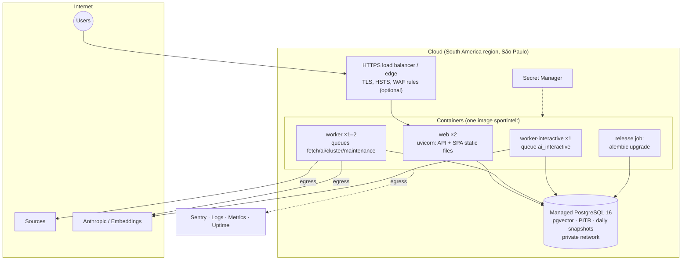

**Decisions:**

| Decision | Why | Alternatives | Trade-off |
|---|---|---|---|
| **One image, several process types** (web / worker / worker-interactive / release) | One build and one code version in every process, no drift | A separate image per module | The image includes the dependencies of every process (the worker's trafilatura ends up in web too). Acceptable |
| **A managed container platform** (Cloud Run / ECS Fargate / Fly.io / Render) | No server administration, rolling deploys, secrets, logs | Kubernetes (overkill for 3 processes and a small team); a VM + Docker Compose (cheap, but manual TLS, updates and deploys) | Platform lock-in is softened by packaging everything as standard Docker without platform APIs. **The budget option:** one VM + Docker Compose + Caddy, the same architecture with no code changes |
| **Managed PostgreSQL** with pgvector | Backups, PITR, upgrades, monitoring | Self-hosted PostgreSQL | Cost; the provider must support pgvector and unaccent |
| **The São Paulo region** | Close to the sources (faster fetches) and the target audience; data residency for the Brazilian market | An EU region (if the team is there) | ~150–200 ms extra UI latency for a remote team. Acceptable for a desktop tool |
| **The SPA is served by the web process** | One origin: simple cookies and CSP, no CORS | CDN/S3 for static files | No edge cache. Irrelevant for 20 users; a CDN can sit in front of the same origin |
| **The worker accepts no inbound traffic**, egress is allowed to the outside and the database | Isolates the SSRF surface | — | — |

### 29.2. Rollout strategy

- **Rolling deploy** of web (at least 2 instances → no downtime) gated by the readiness probe.
- Worker: **graceful shutdown**. On SIGTERM, jobs are finished (60 s timeout); unfinished ones go back to the queue (jobs are idempotent).
- **Migrations:** a separate release step **before** the code rollout, backward-compatible only (expand). Dropping columns (contract) happens in the next release. Heavy data changes run as background jobs, not in a migration. Indexes use `CREATE INDEX CONCURRENTLY`.
- **Rollback:** redeploy the previous image (migrations are compatible with N-1). Migrations are **not** rolled back in production; a roll-forward is released instead.
- **Prompts and models:** a new prompt version is enabled first through `prompt.<task>.canary` for admins, then for everyone. Rolling back a prompt is a settings switch without a deploy.
- **Backups and restore:** PITR for 7–14 days + a daily snapshot. **RPO ≤ 5 min, RTO ≤ 2 h** (an internal tool). Restores are tested quarterly on staging.
- **Why not blue/green or canary traffic:** with ~20 users, rolling + a fast image rollback give the same effect more simply.

### 29.3. Current implementation: a single machine (ADR-005)

Until there is a budget for a managed platform, production and staging use the budget option from the §29.1 table. The root `compose.yaml`:
- caddy (HTTPS) → web; worker; db (PostgreSQL 16 + pgvector, no exposed port);
- a one-off migrate;
- backup (scheduled `pg_dump`);
- optionally ollama.

Installing and updating: `docker compose up -d --build`, see [deploy/README.md](../deploy/README.md).

Differences from §29.1–29.2:

| Target | Now | How it is covered |
|---|---|---|
| Rolling deploy, web ×2 | web ×1, a restart takes seconds | Caddy `lb_try_duration 30s` holds requests |
| PITR, RPO ≤ 5 min, RTO ≤ 2 h | a dump every `BACKUP_INTERVAL_H` (24 h), RTO ~30–60 min | a dump freshness healthcheck; a quarterly restore test |
| Secret Manager | `.env` on the server | a file outside git, readable only by its owner |
| Managed observability | Docker logs (rotated), `deploy/capacity.sql`, Telegram alerts, optional Sentry | [OPERATIONS.md](OPERATIONS.md) §2 |
| A migration release job | the `migrate` service before web/worker (`service_completed_successfully`) | the same behaviour |

The signals and the ladder towards §29.1 (vertical → worker → separate AI → managed database → web replicas → platform) are described in [OPERATIONS.md](OPERATIONS.md) §4–5.

---

## 30. CI/CD

### 30.1. Pipeline

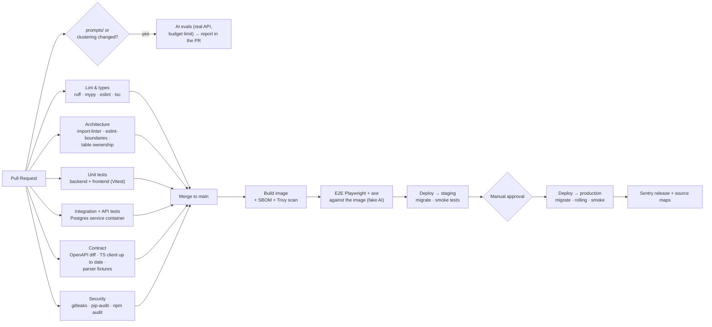

### 30.2. Rules

- **Trunk-based:** short-lived branches, squash merge into `main`, `main` is always deployable.
- **Required checks** for a merge: everything except evals. Evals are required only when `prompts/**`, `modules/events/domain/policies/clustering.py` or model routing change. A metric regression beyond the tolerance blocks the merge (§31.4).
- **Artifact:** an image tagged with the git sha. The same image goes through staging and prod (build once, deploy many).
- **Production:** manual approval (GitHub Environments) + an automatic smoke test (`/readyz`, a service user sign-in on staging, `GET /events`).
- **Nightly CI jobs:** a full evals run on a fresh staging sample, dependency update PRs (Renovate), a backup restore test (quarterly).
- **Why GitHub Actions:** integrated with the repository, Environments with approval, enough free minutes for the volume.
- **Alternatives:** GitLab CI, CircleCI: equivalent. The choice follows the repository hosting.
- **Trade-off:** the manual production gate slows rollouts. It can be dropped once smoke tests and monitoring are reliable.

---

## 31. Testing strategy and architecture

### 31.1. The pyramid

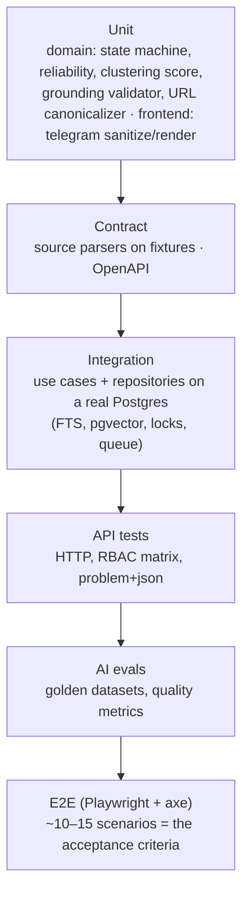

### 31.2. Test layers

| Layer | What it covers | Tools | Speed / when |
|---|---|---|---|
| **Unit (domain)** | The state machine (every allowed and forbidden transition × roles), `ReliabilityPolicy` (the rule table as a table-driven test), clustering scoring, `GroundingValidator` (numbers, quotes, names, missing references), the canonicalizer, the Telegram HTML sanitiser. **The most important trust guarantees are tested here deterministically** | pytest, hypothesis (properties of the canonicalizer and sanitiser) | Seconds, on every commit |
| **Contract (parsers)** | For each source profile, saved RSS and HTML → the expected title, lead, published_at, image. A weekly job refreshes the fixtures from the real sites and shows a diff (early detection of layout changes) | pytest + fixtures | Seconds |
| **Contract (API)** | `openapi.json` in the repository matches the generated one; the TS client is up to date; breaking changes (oasdiff) are forbidden without an explicit label | oasdiff | CI |
| **Integration** | A whole use case on a real PostgreSQL: ingestion → enrichment (fake AI) → clustering → refresh; concurrent clustering (two articles about one fact in parallel produce **one** Event); pt-BR search (accents, stemming); keyset pagination; transactional job enqueueing; append-only audit | pytest + testcontainers, fake `LlmClient`/`EmbeddingClient`/`HttpFetcher` | Minutes, per PR |
| **API** | Authentication and sessions, CSRF, the RBAC matrix (every endpoint × role, generated from the permission table), the error format, `If-Match`/409, idempotency | httpx AsyncClient | Per PR |
| **Frontend component** | Filters ↔ URL, the list, the Telegram preview (rendering bold/italic/links/emoji/hashtags), copy (html + plain), the conflict banner, AI labelling, autosave | Vitest + Testing Library + MSW | Seconds |
| **E2E** | Scenarios per acceptance criterion: a new article from a fixture source appears; 3 articles → 1 Event; filter + search; open the sources; preview, edit, copy; workflow + reject with a reason; a conflict is visible; an unverified sentence is highlighted. axe reports no violations on any screen | Playwright, a Docker stack with fake AI and a fake source (a static HTTP server with fixtures) | ~5–10 min, after merge |
| **AI evals** | See §31.4 | A pytest-based harness, the real API | When prompts change, nightly |
| **Smoke** | After a deploy | curl/Playwright | A minute |

### 31.3. Test doubles (for external systems only)

- `FakeLlmClient`: answers from fixtures, matched by `(task, input_hash)`. In "record" mode it writes real answers into fixtures.
- `FakeEmbeddingClient`: deterministic vectors (a hash projection) so that similar texts are "similar".
- `FakeHttpFetcher` / a static source server: RSS and HTML fixtures.
- `FrozenClock`.
- **The database is not mocked** (§5.1).

### 31.4. AI evals (quality as a test)

| Set | Initial size | Metric | Blocking threshold |
|---|---|---|---|
| Sport classification | 300 labelled pt-BR articles | accuracy, macro-F1 | a drop > 2 pp |
| Entity extraction + linking | 200 articles | entity precision/recall | a drop > 3 pp |
| Relevance | 300 articles labelled by editors following the rubric | weighted F1, **HIGH recall** | HIGH recall < 0.85 |
| Clustering | 50 "days" of news (~1500 articles) with reference events | B-cubed F1, false merge rate | false merges grow > 1 pp |
| Conflict detection | 60 conflict / no-conflict pairs | precision/recall | recall < 0.8 |
| **Draft grounding** | 100 events | Share of sentences without a citation, share of facts outside the evidence (automatically by the validator + an LLM judge + spot checks by a person), **0 unacceptable "rumour → fact"** | any regression in "rumour → fact" |

- Datasets grow **from real work:** manual merges, moves and overrides, `INCORRECT` rejections and heavily rewritten drafts go into a labelling queue.
- **Why evals are mandatory:** a prompt change breaks behaviour just like a code change, but without failing tests.
- **Trade-off:** evals cost money and time, so they run only on relevant changes and nightly.

### 31.5. Coverage and non-functional tests

- Coverage targets: domain and application ≥ 90 %, overall ≥ 80 %. An indicative metric, not a goal in itself.
- **Performance:** a k6 scenario on staging (filtered list, search) on a year's worth of data (3 million synthetic articles) → p95 < 300 ms. Run before releases with schema changes.
- **Security:** SSRF API tests (private IPs, redirects, DNS rebinding), XSS payloads through the sanitiser, the RBAC matrix; an annual external pentest is optional.

---

## 32. Folder structure (full)

```text
sportintel/
├── README.md                       # running, configuration (§23 table), links to docs
├── docs/
│   ├── OPERATIONS.md
│   ├── ARCHITECTURE.md             # this document
│   └── adr/                        # ADRs as new decisions are made (format §1.3)
├── backend/                        # see §5.2
│   ├── pyproject.toml
│   ├── alembic.ini
│   ├── migrations/
│   ├── src/sportintel/
│   │   ├── main.py
│   │   ├── worker.py
│   │   ├── platform/
│   │   └── modules/{identity,sources,ingestion,taxonomy,intelligence,events,editorial,audit,analytics}/
│   │       ├── public.py
│   │       ├── domain/
│   │       ├── application/
│   │       ├── infrastructure/
│   │       ├── api/
│   │       └── jobs.py
│   └── tests/{unit,contract,integration,api,architecture,evals}/
├── frontend/                       # see §14.2
│   ├── package.json
│   ├── src/{app,pages,features,entities,shared}/
│   └── tests/{e2e,setup}/
├── evals/
│   └── datasets/                   # labelled sets (versioned; large ones in object storage with a manifest)
├── fixtures/
│   └── sources/<profile>/          # RSS/HTML fixtures (shared by contract, integration and e2e)
├── deploy/
│   ├── Dockerfile                  # multi-stage: build frontend → build backend → runtime (non-root)
│   ├── compose.local.yml           # postgres+pgvector, app, worker, fake source server
│   ├── Caddyfile, backup.sh, capacity.sql, README.md   # production setup (ADR-005)
│   └── platform/                   # manifests for the chosen platform (Cloud Run / Fly / ECS), later
├── compose.yaml                    # single-machine production setup (ADR-005), .env.deploy.example
├── openapi.json                    # the pinned API contract (checked in CI)
└── .github/
    └── workflows/{ci.yml,deploy.yml,evals.yml,nightly.yml}
```

**Why a monorepo:** the frontend, backend and contract change together, one PR is one feature, and OpenAPI synchronisation is checked atomically.
**Alternative:** separate repositories. **Trade-off:** CI must run only the affected parts (path filters).

---

## 33. Architecture evolution, risks and open questions

### 33.1. The road ahead (post-MVP and future)

| Capability | Where it fits in the architecture | What gets added |
|---|---|---|
| Breaking news detection | events: the growth rate of independent sources within a window | A policy + a flag + a notification (§16) |
| Trending topics / most discussed | analytics: aggregates over `event_entities` per window | Materialized views |
| Source reliability history | sources + events: the share of confirmed and refuted claims per source | Recomputing `tier` as a recommendation for the Admin |
| Event timeline | events: timestamped claims sorted by article | A read model, no new infrastructure |
| Automatic story angles, image suggestions | editorial: new AI tasks through the same gateway and grounding | Prompts + evals |
| Telegram publishing after approval | editorial: the `TelegramPublisher` port, READY → PUBLISHED automatically | The `telegram_publish` flag, audit, a repeated role check (implemented as channels, see ADR-05) |
| Advanced taxonomy | taxonomy: a competition hierarchy, external IDs (a fixtures provider) | Tables + a `FixturesProvider` integration |
| A sports intelligence platform | New bounded contexts (Trends, Opportunities) on top of the same Events | New modules, the same monolith |

### 33.2. When to change key decisions (triggers)

| Decision | Revisit if |
|---|---|
| Monolith → extract a service | Ingestion/AI load needs scaling incompatible with web (e.g. GPUs for local models), or a second team with its own release cycle appears. The first candidate is **ingestion + intelligence** as a separate worker service (it already has a clear output contract, `ArticleEnriched`) |
| PostgreSQL FTS → OpenSearch | More than 20–30 million articles, or synonyms, highlighting and facets with p95 < 300 ms are needed and unreachable in PostgreSQL |
| pgvector → a specialised vector database | More than 10–20 million vectors and degraded HNSW recall/latency |
| Procrastinate → a broker | > 500 jobs/s sustained, or fan-out to many consumers is needed |
| Polling → SSE | More than 50 users, or a requirement for second-level latency |
| In-process cache → Redis | web > 2 instances, or an exact distributed rate limit is needed |
| Our own flags → Unleash | Percentage rollouts and experiments are needed |

### 33.3. Main risks

| Risk | Probability / impact | Mitigating architectural decision |
|---|---|---|
| Clustering errors (merging different facts or splitting one) | High / high | Hybrid scoring, an LLM in the grey zone, manual merge/move, evals, a manual-correction metric |
| AI presents a rumour as a fact | Medium / critical | Deterministic reliability, the grounding validator, disclaimers inserted by code, human in the loop (only an Editor sets READY) |
| Source parsers break silently | High / medium | Contract fixtures, a "source is silent" alert, preferring RSS |
| ToS and copyright | Medium / high | `content_policy`, text TTL, robots.txt, only links and paraphrases; **a legal review of the source list before launch** |
| Growing AI costs | Medium / medium | One call per article, a cheap model for bulk work, caching, prompt caching, a budget and circuit breaker |
| Sources block our IP | Medium / medium | Polite fetching (per-host rate, an honest User-Agent, conditional GET); if needed, agreed access or feeds |

### 33.4. Open questions (they affect the architecture but do not block it)

1. **Is there a corporate IdP** (Google Workspace / Entra)? If not, the fallback is used (§11; implemented as password sign-in, ADR-005).
2. **The source list and its ToS:** which allow HTML scraping and which only RSS? This sets the default `content_policy`.
3. **The Telegram channel language** and the team's interface language? (Implemented: per-channel post language, UI in en/ru.)
4. **Is four-eyes role isolation needed** (a Researcher cannot set READY on their own draft, even after becoming an Editor)?
5. **The "minimal" target latency:** confirm an SLO of p95 ≤ 10 min, or stricter (then more frequent polling and SSE are needed)?
6. **Cloud provider and budget:** they decide between a managed platform and the VM option (§29); the architecture does not change.
7. **Image storage:** only the source's `image_url` (the current decision, no copying because of copyright), or our own copies for the Telegram post?
